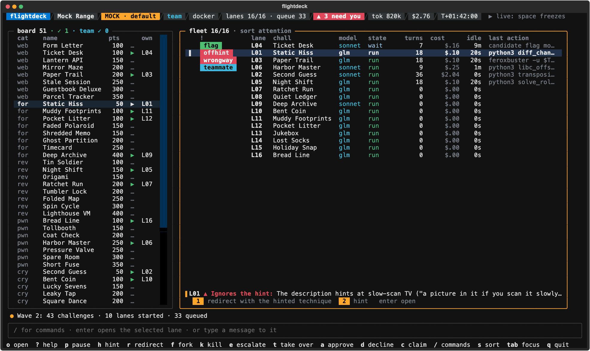
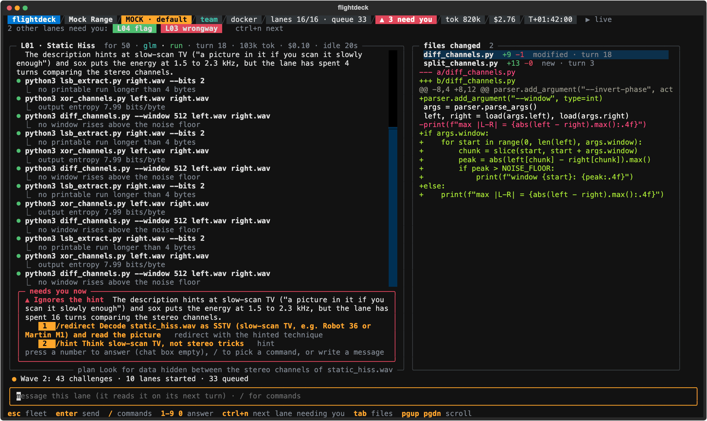

# ctf-flightdeck

A terminal harness for playing CTFs with AI agents, where **you** run the loop.

flightdeck pulls the board, runs your own no-model solvers first, starts agent lanes in parallel,
and submits flags, while you watch every lane on one console and step in when one goes the wrong
way: a hint, a redirect, a fork, a kill, or taking over its shell yourself.


*The fleet view, from `flightdeck mock`: scripted lanes on invented challenges. More in the
[screenshot gallery](docs/SCREENSHOTS.md).*

Bring what you have: an API key (Anthropic, OpenRouter, OpenAI or a local model server), a
coding-agent CLI (Claude Code, Codex), a folder of solver scripts.

> **Status: pre-release (v0.1.0 coming).** Milestones M0 to M4 are built: the console, agent
> lanes, your L1 solvers, CTFd events, team mode, alerts, practice scoring, post-flight reports.
> See [`docs/ROADMAP.md`](docs/ROADMAP.md) and [`CHANGELOG.md`](CHANGELOG.md).

## Quickstart

Needs Python 3.12+ on macOS or Linux (Windows through WSL), and Docker for the safest setup.

```sh
pipx install ctf-flightdeck     # or: uv tool install ctf-flightdeck   (from a clone: uv tool install .)
flightdeck init                 # a few questions; writes your config and says what to do next
flightdeck practice             # 14 small practice challenges that ship with flightdeck
```

`flightdeck` on its own says what to do next on your machine, and `flightdeck doctor` checks
everything (Python, the config, the key variables, a local model server and its models, the
light model, Docker, the lane image, your terminal's size) and says how to fix each problem.
Before the console opens, `play` and `practice` ask the model API whether it takes your key and
serves every model in your ladder, and stop with what to fix if not. No setup at all:
`flightdeck mock` opens the console on scripted data and spends nothing.

## Keys and model APIs

Your config names the environment variable that holds each key, never the key. flightdeck reads
the variable from your environment, else from `~/.config/ctf-flightdeck/keys.env` (or the file
`$FLIGHTDECK_KEYS` names), which must be readable by you only:

```sh
mkdir -p ~/.config/ctf-flightdeck && touch ~/.config/ctf-flightdeck/keys.env && chmod 600 ~/.config/ctf-flightdeck/keys.env
# then add lines like:  ANTHROPIC_API_KEY=...   OPENROUTER_API_KEY=...
```

A lane's commands get an environment built from an allowlist, so flightdeck hands them none of
these values (but see `--host` below). A coding-agent CLI (`--agent`) gets its own credential and
no other, and the commands it runs can read that one, in Docker too: give it a key you can
revoke, with a low spending limit.

With an Anthropic key, `flightdeck init --provider anthropic` writes Claude Haiku, Sonnet and
Opus 5.5 with their list prices, so the dollar caps work from the start. If `OPENROUTER_API_KEY`
is set too, it offers OpenRouter as the fallback for a lane whose calls to Anthropic keep
failing. OpenRouter, OpenAI, Ollama, an MLX server or any OpenAI-compatible API work as well.
For Ollama or an MLX server, `init` suggests a model, and for any server on your machine it lets
a lane wait up to 10 minutes for a reply of up to 8192 tokens, since a local model can take
minutes to answer. The fallback, what happens when a model declines, fast mode, time and reply
limits, and prices: [`docs/MODEL-APIS.md`](docs/MODEL-APIS.md).

## Models

Which models fit your machine? `flightdeck models` looks at it (chip, memory, NVIDIA GPUs, and
the model servers running on it; it contacts nothing but 127.0.0.1) and lists, for lanes and for
the light model, the models that fit and why: open-weight models on your machine first where
they run well, then model APIs. `flightdeck models qwen3.5-9b` prints how to get one and the
config lines that use it. It recommends; it never changes your config. How the models did:
[`docs/MODELS.md`](docs/MODELS.md).

## Play a board

```sh
flightdeck play ~/ctf/some-board --max-lanes 4
```

A board is a folder of challenge folders, each with a `challenge.json` and its handout files
(format in [`docs/ARCHITECTURE.md`](docs/ARCHITECTURE.md)). Lanes start cheapest-first; the rest
queue. Every lane is a model conversation, capped per lane by `token_cap` and `dollar_cap` (an
alert at 80%, your approval at 100%).

A flag a lane finds waits for you: `a` or `1` submits it, `d` or `0` declines. Under auto submit
(`submit = "auto"`, or `play --submit auto`) a flag the model submits goes at once, unless it is
written in the challenge's own description or handout files (often a decoy): that one still
waits for you. A flag found wrong is never asked about again.

The console raises an alert when a lane spends big on a low-value challenge, ignores what the
description hints at, heads the wrong way on web, loops or stalls. Lanes that need you sort
first, and the line under the list says why and numbers the answers: one key answers.



*An alert with its quick answers, from `flightdeck mock` (invented challenges).*

**Enter** opens a lane full screen: its transcript, the files it changed with diffs, and a chat
box (plain text is a message to the lane; `/redirect`, `/approve`, `/diff` and the rest are
commands; `esc` goes back).



*A lane full screen, from `flightdeck mock` (invented challenges).*

`t` takes over a lane's shell (its container in Docker): exit it to hand the lane back, and the
lane hears what you changed. The shell starts clean: it reads no startup file, and with `--host`
its HOME is a new folder only you can read, outside the workspace, so nothing the lane wrote runs
before you type. `e` escalates a lane to a stronger model with a summary of what it did, `f`
forks it, `?` shows every key.

When a model API failure would hit every lane (a refused key, an unknown model, no credits), the
queue is held and the header says why. Once you have fixed it, `/unhold` starts the queued lanes
(a key or model id changed in your config needs a new run).

Docker lanes get no network unless their challenge has a live instance (a web origin, or a TCP
service like `nc host port`: `tcp://host:port` in a challenge's `urls`). `--host` runs lane
commands as you, on this machine: a lane can read your files, your keys file and flightdeck's
own environment, and what it reads goes to its model and onto your screen. Transcripts and
writeup drafts take out what looks like a key or token (see [After a run](#after-a-run)), but
that is cleanup, not a fence: use Docker, a disposable VM, or a separate low-limit key.

Every run writes an append-only `events.jsonl` and each lane's transcript; a board with answers
(like the practice set) ends with a scorecard. `q` asks first while lanes are open, and a run
cannot be resumed. If flightdeck itself is killed (kill -9, a power loss), what its lanes started
can keep running: the next `play` or `practice` removes it and says what it removed,
`flightdeck doctor` lists it and `flightdeck doctor --clean` removes it.

## Play an event

Write down what the event's rules allow, check it, and play by it:

```sh
flightdeck preflight --example > event.toml      # then edit it from the event's rules
flightdeck preflight event.toml                   # what flightdeck will do at each stage, and any problem
export CTFD_TOKEN=...                             # the variable event.toml names (never the token itself)
flightdeck play ~/ctf/event-board --event event.toml
```

With a CTFd event, flightdeck pulls the board into that folder, adds new waves as they appear,
submits the flags you approve through CTFd and follows your team's solves. A slow CTFd never
holds up the console: lanes carry on while their flags are on their way (the fleet shows
`sending`). A challenge whose tries CTFd counts always waits for you, under `auto` too, and each
approval says how many tries are left. Each stage (pull, L1, agents, submit, live instance) runs
as the profile's policy says: `auto`, `confirm` (you say yes first), `manual` or `off`, never
looser than the rules. Under `confirm` for live instances, a lane asks before it may reach its
challenge's instance and has no network until you allow it.

Team mode shares claims, live-box holds and solves through a folder your teammates sync (a network
drive, Syncthing): `flightdeck team init DIR` once, then `--team-dir DIR`. Your lanes never work a
challenge a teammate solved.

`--agent claude` (or `codex`) runs lanes as that coding-agent CLI, with its own login and models
(`[agents]` in your config), behind the same controls. Check it first with
`flightdeck doctor --agent claude`. A CLI says what a turn cost only when the turn ends, so its
lane's cost ends in `…` until then; codex reports no cost at all, so give its models a
`[prices."<model>"]` table for their lanes to show dollars.

## Your solvers first (L1)

Point flightdeck at a folder of your no-model solvers and each of flightdeck's own lanes runs the
ones that fit its challenge before its first model call (coding-agent lanes do not use the pack
yet), so a solve can cost no tokens at all. A flag an engine returns as its result waits for your
approval, or under auto submit goes to the platform at once; a flag that is only a match in what
an engine printed (a plain script that `l1 import` took in, say) always waits for you. When lanes
run in Docker, so do your solvers: each in a container of the lane image, your pack mounted
read-only, with no network unless the live-instance policy is `auto` and the challenge has an
instance. With `--host` they run on this machine, as you.

```sh
flightdeck l1 import ~/ctf/solvers        # manifests for a folder of plain scripts (the scripts are never changed)
flightdeck l1 route ~/ctf/solvers ~/ctf/some-board/crab-walk   # which engines a challenge reaches, and why (or why not)
flightdeck play ~/ctf/some-board --pack ~/ctf/solvers          # or set [l1] pack in your config
```

## After a run

```sh
flightdeck report RUN_DIR      # where lanes stalled, which interventions helped, cost per solve
flightdeck writeups RUN_DIR    # a writeup draft per solved challenge (--redact hides the flags)
flightdeck score RUN_DIR       # the run scored against the board's answers
flightdeck gaps RUN_DIR        # the challenges your L1 solvers did not solve, and why
flightdeck build gap CHALLENGE_DIR --pack ~/ctf/solvers   # a new engine stub with a test that must pass
```

When a run ends, `play` prints its run folder with the report, writeups and gaps commands for it
(and score, when the board has answers), ready to paste. Writeup drafts and lane transcripts
take out what looks like a key or token, with or without `--redact`: the value of an upper-case
`NAME=value` or `NAME: value` whose name holds KEY, TOKEN, SECRET, PASSWORD, PASSWD, COOKIE or
AUTH, of an Authorization or Cookie header, and of a key with a well-known prefix (`sk-ant-`,
`ghp_` and the like) becomes `[redacted]`. Anything else stays, lower-case names included (a
`password` is everyday CTF content), so read a draft before you share it.

## Light model

A few small jobs can use a small model. Today that is the hint judge: when a lane seems to ignore
what its description hints at, the alert shows at once, and the light model checks the lane's
steps; if it says the lane is using the technique after all, the alert comes down. By default
there is no light model, only the rules. Five choices, in `[light]`:

- `rules`: no model (the default).
- `openai`: any OpenAI-compatible server. **Recommended: an open-weight model on your own
  machine**, served by Ollama (`http://127.0.0.1:11434/v1`) or an MLX server
  (`http://127.0.0.1:8080/v1`), with `key_env = ""`. No provider's safety classifier stands
  between it and security work, and it costs nothing. flightdeck asks a model on your machine to
  answer without thinking first (`thinking = false`, the default there): one that reasons first
  spends a small job's few hundred tokens thinking and answers nothing.
- `anthropic`: a Claude model (`claude-haiku-5-5`, say).
- `cactus`: Cactus Needle, on this machine (the `[cactus]` extra).
- `decider`: Strands Decider, a decision model, served on your own machine. It writes no text: it
  picks one of the options and says how confident it is. An answer below `threshold` (0.9 by
  default; its README says answers at 0.9 or more are right about 95% of the time on short tasks
  it has never seen) is unsure, and the rules' answer stands. No key, and nothing to pay.
  `flightdeck init --light decider` writes it and says how to start its server:
  `pip install strands-decider`, then
  `strands-decider serve StrandsAgents/strands-decider-2B-qwen3.5-v1-2610 --port 8000` (on Apple
  silicon add `--device mlx`, with its `mlx` extra: `pip install "strands-decider[mlx]>=0.3"`).

Measure one before you switch it on: which models to try, and how they did, is in
[`docs/MODELS.md`](docs/MODELS.md). `eval-local` decides:

```sh
flightdeck eval-local --engine openai --base-url http://127.0.0.1:11434/v1 --model <model> \
    --compare anthropic:claude-haiku-5-5 --compare cactus
flightdeck eval-local --engine decider --base-url http://127.0.0.1:8000   # or a column: --compare decider@URL
flightdeck init --light ollama --light-model <model>     # or edit [light]; at a terminal, init suggests a model
```

eval-local runs each engine and the rules over the bundled cases (naming the hinted technique,
judging a lane, summarising one) and prints them side by side: accuracy, refusals and failures,
time and cost per job. A paid API is announced first with its number of calls: one per case,
never a retry. `--thinking on|off` says whether a model on an OpenAI-compatible server may think
first; by default it is off on your machine and on elsewhere, unless your `[light] thinking`
says otherwise for that server. The decider's unsure answers get a row of their own and count
neither right nor wrong, so its accuracy says how often an answer it was sure of is right; its
summary cases show as n/a, since a decision model writes no text.

The light model never holds anything up. When it refuses, fails, times out, answers outside the
options or (the decider) is unsure, the rules' answer stands, and the run says so once. A refused
request is never sent on to another model or provider: you see the refusal and decide.

## Try the mock

```sh
flightdeck mock                      # the default scenario: every alert, then a 43-challenge wave
flightdeck mock --scenario wave      # also: sstv, overthinking, web, team, flag
flightdeck mock --screenshot DIR     # headless: SVGs of the key moments
```

The fleet's keys act on the selected lane: `p` pause, `h` hint, `r` redirect, `f` fork, `k` kill,
`e` escalate, `t` take over, `a` approve, `d` decline, `1`-`9`/`0` quick answers, `c` claim
(team), `/` commands, `s` sort, `?` help, `q` quit; **Enter** opens the lane full screen. In the
mock, `space` freezes the clock and `.` steps it. All challenges, teammates and flags there are
invented.

## Optional extras

- `ctf-flightdeck[cactus]`: Cactus Needle, a small on-device model, one of the light model's
  choices (`flightdeck eval-local --engine cactus` measures it against the rules first). Its
  telemetry is turned off. Nothing uses it unless you ask.
- `ctf-flightdeck[build]`: pytest, for `flightdeck build check`.

## Docs

[Vision](docs/VISION.md) · [Decisions](docs/DECISIONS.md) · [Roadmap](docs/ROADMAP.md) ·
[Console spec](docs/CONSOLE-SPEC.md) · [Architecture](docs/ARCHITECTURE.md) ·
[Model APIs](docs/MODEL-APIS.md) · [Models](docs/MODELS.md) · [Screenshots](docs/SCREENSHOTS.md) ·
[Changelog](CHANGELOG.md)

Development: `uv run pytest`. `ctfdeck` is an alias for `flightdeck`.

## License

MIT. See [LICENSE](LICENSE).
