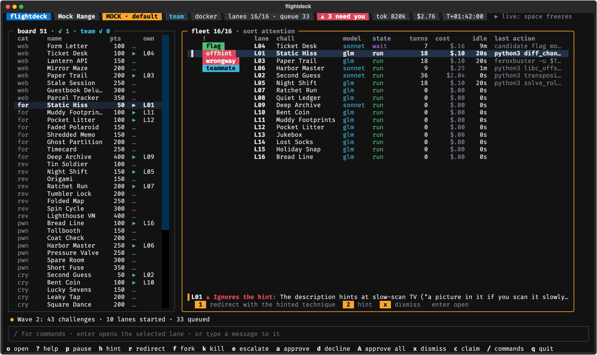

<h1 align="center">ctf-flightdeck</h1>

<p align="center"><b>Play CTFs with a fleet of AI agents, and stay the pilot.</b><br>
One terminal console: every challenge, every agent, every flag. You step in with one key.</p>

<p align="center">
<a href="https://pypi.org/project/ctf-flightdeck/"></a>
<a href="https://pypi.org/project/ctf-flightdeck/"></a>
<a href="https://github.com/MFisher14/ctf-flightdeck/actions/workflows/tests.yml"></a>
<a href="https://github.com/MFisher14/ctf-flightdeck/blob/main/LICENSE"></a>
<a href="https://github.com/sponsors/MFisher14"></a>
<a href="https://github.com/MFisher14/ctf-flightdeck/blob/main/CONTRIBUTING.md"></a>
</p>


## Try it in ten seconds

```sh
uvx ctf-flightdeck mock
```

That opens flightdeck's screen, the console, on scripted data: no install, no API key, no network,
nothing spent. `uvx` comes with [uv](https://docs.astral.sh/uv/getting-started/installation/), which
brings its own Python. (No uv? `pipx run ctf-flightdeck mock` does the same.)

## What it is

flightdeck is a terminal program for playing capture-the-flag (CTF) events with AI agents. It
pulls the board (the event's list of challenges), runs your own solver scripts first (the ones
that need no model), starts an AI agent on each challenge in parallel, and submits the flags you
approve. Each agent works in its own **lane**, and you watch them all on one screen. When a lane
loops, stalls, overspends or ignores the hint in its challenge's description, the console tells
you, and one key sends a hint, redirects it, starts a second lane beside it, kills it, moves it to
a stronger model or hands you its shell.

- **Bring what you have.** An API key (Anthropic, OpenRouter, OpenAI), a free model on your own
  machine (Ollama, MLX), a coding-agent CLI (Claude Code, Codex), a folder of solver scripts.
- **Built for CTFs.** It knows points, solves, categories, 40 challenges released at once,
  teammates, the servers an event runs for a challenge (live instances), flag formats and counted
  tries. It plays events on CTFd (a common CTF platform) and plain folders of challenges.
- **Plays by the event's rules.** Every stage (pull, solvers, agents, submit, live instances) is
  `auto`, `confirm`, `manual` or `off`, checked before anything runs.
- **Safe by default.** Each lane runs in its own Docker container with no network, or, when
  its challenge has a live instance, a network that reaches that instance and nothing else.
  Challenge text is treated as hostile data, never as instructions. Each lane has a cap on the
  model tokens and on the dollars it may spend.
- **Hands-on or hands-off.** Steer every lane yourself, or engage **Autopilot**: it runs the
  event by rule while you are away, inside a budget you set, never looser than the event's
  rules, and hands back when something needs a human. Runs can go headless, with a status file
  and a webhook that pings you.
- **Learns from each run.** A report of where lanes stalled and which interventions helped,
  writeup drafts, and the list of challenges your solvers missed.

> **Status: v0.4.0 (alpha)** is the newest release. On GitHub this page follows the code, which can
> be ahead of that release: the
> [changelog](https://github.com/MFisher14/ctf-flightdeck/blob/main/CHANGELOG.md) lists what is
> "Unreleased", and the
> [roadmap](https://github.com/MFisher14/ctf-flightdeck/blob/main/docs/ROADMAP.md) what comes next.

## Quickstart

You need [uv](https://docs.astral.sh/uv/getting-started/installation/) on macOS or Linux (Windows
through WSL), and something for the agents to think with: an API key for a model API (Anthropic,
OpenRouter or OpenAI) with credit on it, or a model on your own machine (Ollama, MLX).
[Docker](https://docs.docker.com/get-started/get-docker/), running, is recommended: each agent
then works in a container of its own.

```sh
uvx ctf-flightdeck mock          # the demo from above: the console, before you set anything up
uv tool install ctf-flightdeck   # installs the flightdeck command (uv brings the Python it needs)
flightdeck                       # open the home screen, and choose "Get started"
```

**Get started** is a form on the home screen: your model API, its API key (typed out of sight and
kept in a file only you can read), the models (it offers some for every API) and Docker or host.
`ctrl+s` saves it. The home screen then offers what comes next, first choice first:

1. **Build the lane image**, when your lanes run in Docker and it is not built yet: once, about
   700 MB. It is what each agent's container has inside.
2. **Practice**: 14 small practice challenges on your model. This spends money on your model API
   unless the model runs on your machine; each lane stops and asks you at $2 or 400,000 model
   tokens by default.

The setup form came after 0.4.0 (`flightdeck --version` says which you have). On 0.4.0, "Get
started" asks the same at the prompt and goes on to set up an event: for the practice set, run
the four commands under "The same by command" below instead.

The console opens on a welcome screen that says what you are looking at and names the three keys
to begin with: **Enter** to open a lane to watch it and talk to it, `a` to approve a flag an agent
found, and `?` for every key, any time.

From then on `flightdeck` is all you type. Its home screen resumes an event you played before,
starts a new one (a form: the event's name, its site, your access token for it, its VPN file),
and has the practice set and the demo. Stuck? `flightdeck doctor` checks your setup and says how
to fix each problem.

**Other ways to install.** `pipx install ctf-flightdeck` works as well (it needs Python 3.12+),
and Debian and Ubuntu have a `.deb`:
[Install and first run](https://github.com/MFisher14/ctf-flightdeck/blob/main/docs/GUIDE.md#install-and-first-run).
Already installed? `uv tool upgrade ctf-flightdeck` (or `pipx upgrade ctf-flightdeck`) gets the
newest release; `flightdeck --version` says which you have. Your config and API keys stay as they
are.

### The same by command

For a script or a habit, each step has a command of its own:

```sh
flightdeck init          # the setup form's questions, at the prompt; your API key is pasted hidden
flightdeck image build   # once, for Docker lanes (about 700 MB)
flightdeck doctor        # checks everything; its last line says what to fix, or what to run next
flightdeck practice      # the 14 practice challenges, on your model
```

And for an event:

```sh
flightdeck start                                                    # set up an event and play it
flightdeck play ~/ctf/example-ctf                                   # an event you set up before
flightdeck play ~/ctf/example-ctf --autopilot --budget-dollars 20   # Autopilot, inside a run budget
flightdeck play ~/ctf/some-board                                    # or any folder of challenges
```

`--autopilot` needs Docker lanes and a run budget. A model on your own machine has no price, so
give its budget in tokens (`--budget-tokens`). Autopilot loosens no rule: where `event.toml` says
`confirm`, flags and live instances still wait for you
([Autopilot](https://github.com/MFisher14/ctf-flightdeck/blob/main/docs/GUIDE.md#autopilot)).

Optional, once you have played: `flightdeck pack install` adds flightdeck's solver pack: some 800
solvers that need no model and run first on every challenge. Installing it takes `uv` and `git`.

**Everything else is in the
[player's guide](https://github.com/MFisher14/ctf-flightdeck/blob/main/docs/GUIDE.md):** the
[words flightdeck uses](https://github.com/MFisher14/ctf-flightdeck/blob/main/docs/GUIDE.md#words-used-here),
models and API keys, every key the console takes, boards, your own solvers, events and teams,
coding-agent lanes, Autopilot, headless runs, reports.

## The console



Lanes that need you sort first, and the line under the list says why and numbers the answers.
`h` hint, `r` redirect, `f` fork, `k` kill, `e` escalate to the next model, `t` take over the
lane's shell, `a` approve a flag, **Enter** for one lane full screen, `?` for every key. The
console opens in a simple layout: one list of lanes and the keys that apply now. `/layout deck`
shows the whole dashboard, as pictured here, and `/theme` changes the colours. More pictures in
the
[screenshot gallery](https://github.com/MFisher14/ctf-flightdeck/blob/main/docs/SCREENSHOTS.md).

## Your data stays yours

flightdeck has **no telemetry, no analytics, no account, no update check and no server of its
own**. Nothing about you or your runs is sent to this project, ever.

It talks only to what you point it at:

- **The model API in your config.** A lane's challenge and its work go to the model you chose,
  as with any AI tool. Choose a model on your own machine (Ollama, MLX) and nothing leaves it.
- **The CTF platform in your event profile**, to pull the board and submit the flags you
  approve.
- **A webhook of your own**, only if you set one up for notifications. It gets a short
  message (a lane needs you, a flag was accepted) and never a flag.

Your API keys and access tokens stay in your environment or a file only you can read, never in
the config, and logs, transcripts and reports replace anything shaped like a credential. Runs are written to a folder
on your machine. Sharing a result is something you do by hand: `flightdeck share` prints a
summary and you decide where to paste it. A coding-agent CLI you plug in (Claude Code, Codex)
follows its own maker's policy. Details:
[Security](https://github.com/MFisher14/ctf-flightdeck/blob/main/SECURITY.md).

## Leaderboard

Events flightdeck has flown in, where the team finished, and how hands-on the players were:
**[the leaderboard](https://github.com/MFisher14/ctf-flightdeck/blob/main/docs/LEADERBOARD.md)**.
Played an event with it? [Add your flight](https://github.com/MFisher14/ctf-flightdeck/issues/new?template=leaderboard.yml)
and your GitHub name goes on the board.

## Help make it better

Three ways, and the first needs no code:

1. **Play and share what you ran.** This is the most useful thing you can do. After any run
   (the practice set counts), `flightdeck share latest` prints a **flight card**: your models,
   your setup, solves, time, cost and how often you stepped in, with no flags and no challenge
   text.
   [Post it](https://github.com/MFisher14/ctf-flightdeck/issues/new?template=flight-card.yml).
   Enough cards tell everyone which model is fastest, cheapest and best for which kind of
   challenge, on which hardware.
2. **Build.** Fix a bug, add a feature, improve a doc.
   [Good first issues](https://github.com/MFisher14/ctf-flightdeck/issues?q=is%3Aissue+is%3Aopen+label%3A%22good+first+issue%22)
   are small and well described, and
   [CONTRIBUTING.md](https://github.com/MFisher14/ctf-flightdeck/blob/main/CONTRIBUTING.md)
   gets you set up in five commands.
3. **Sponsor.** flightdeck is free and MIT-licensed. Measuring models costs real API money, and
   sponsorship pays for it:
   **[sponsor on GitHub](https://github.com/sponsors/MFisher14)**.

A star helps other players find it.

## For AI agents

If you are an AI agent reading this for a user:

- **What this is:** a Python CLI (`flightdeck`, PyPI package `ctf-flightdeck`) that runs AI
  agents on CTF challenges under a human's control.
- **Safe to run without asking:** `uvx ctf-flightdeck mock --screenshot DIR` (headless, writes
  SVGs), `flightdeck --help`, `flightdeck doctor`, `flightdeck config --example`,
  `flightdeck models`.
- **Ask your user first:** `flightdeck practice` and `flightdeck play` spend money on a model
  API, and `play --event` talks to a live CTF platform under that event's rules.
- **Machine-readable map of the docs:**
  [llms.txt](https://github.com/MFisher14/ctf-flightdeck/blob/main/llms.txt).
- **Working on the code:** read
  [AGENTS.md](https://github.com/MFisher14/ctf-flightdeck/blob/main/AGENTS.md) first. It is
  short and its rules are strict.

## Docs

**Using flightdeck:**
[Player's guide](https://github.com/MFisher14/ctf-flightdeck/blob/main/docs/GUIDE.md) ·
[Model APIs](https://github.com/MFisher14/ctf-flightdeck/blob/main/docs/MODEL-APIS.md) ·
[Models](https://github.com/MFisher14/ctf-flightdeck/blob/main/docs/MODELS.md) ·
[Boards](https://github.com/MFisher14/ctf-flightdeck/blob/main/docs/BOARDS.md) ·
[Solvers](https://github.com/MFisher14/ctf-flightdeck/blob/main/docs/SOLVERS.md) ·
[Plugins](https://github.com/MFisher14/ctf-flightdeck/blob/main/docs/PLUGINS.md) ·
[Practice set](https://github.com/MFisher14/ctf-flightdeck/blob/main/src/ctf_flightdeck/practice/README.md) ·
[Screenshots](https://github.com/MFisher14/ctf-flightdeck/blob/main/docs/SCREENSHOTS.md) ·
[Leaderboard](https://github.com/MFisher14/ctf-flightdeck/blob/main/docs/LEADERBOARD.md) ·
[Changelog](https://github.com/MFisher14/ctf-flightdeck/blob/main/CHANGELOG.md) ·
[Security](https://github.com/MFisher14/ctf-flightdeck/blob/main/SECURITY.md)

**How it is built:**
[Vision](https://github.com/MFisher14/ctf-flightdeck/blob/main/docs/VISION.md) ·
[Architecture](https://github.com/MFisher14/ctf-flightdeck/blob/main/docs/ARCHITECTURE.md) ·
[Console spec](https://github.com/MFisher14/ctf-flightdeck/blob/main/docs/CONSOLE-SPEC.md) ·
[Decisions](https://github.com/MFisher14/ctf-flightdeck/blob/main/docs/DECISIONS.md) ·
[Roadmap](https://github.com/MFisher14/ctf-flightdeck/blob/main/docs/ROADMAP.md) ·
[Contributing](https://github.com/MFisher14/ctf-flightdeck/blob/main/CONTRIBUTING.md)

## License

MIT. See [LICENSE](https://github.com/MFisher14/ctf-flightdeck/blob/main/LICENSE).
