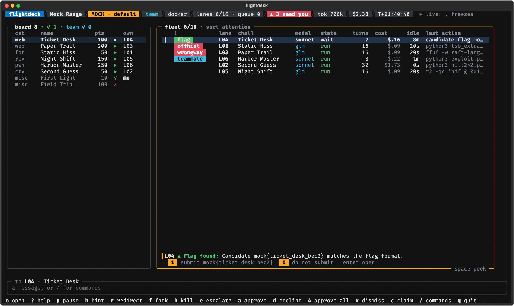
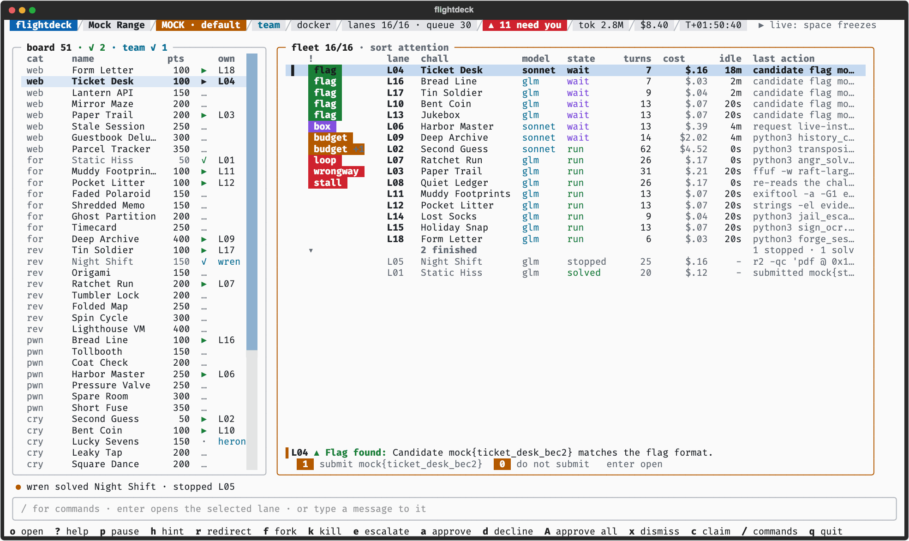

# The player's guide

Everything a player needs after the [README](../README.md)'s quickstart: the words flightdeck uses,
where lanes run, models and API keys, the console, boards, your own solvers, events and teams,
coding-agent lanes, and what a run leaves behind. Deeper pages: [Model APIs](MODEL-APIS.md),
[Models](MODELS.md), [Boards](BOARDS.md), [Solvers](SOLVERS.md), [Plugins](PLUGINS.md) and the
[console spec](CONSOLE-SPEC.md).

## Install and first run

macOS or Linux (Windows through WSL). Install with
[uv](https://docs.astral.sh/uv/getting-started/installation/): it brings the Python flightdeck needs
(3.12 or newer), so you install none yourself.
[Docker](https://docs.docker.com/get-started/get-docker/), running, gives the safest setup ([Docker
or host](#docker-or-host)).

```sh
uv tool install ctf-flightdeck   # installs the flightdeck command
flightdeck                       # the home screen: choose "Get started", then "Practice"
```

If your shell does not find `flightdeck` after that, `uv tool update-shell` puts uv's tool folder on
your `PATH`; open a new terminal then. Without uv, `pipx install ctf-flightdeck` does the same with
a Python 3.12 or newer of your own, and everything below is the same from there. From a clone of the
repository: `uv tool install .`. Debian and Ubuntu have a `.deb`
([below](#install-with-homebrew-or-apt)).

"Get started" sets flightdeck up in a form on the home screen (your model API, its API key, the
models, Docker or host), and the home screen then offers the practice set: 14 small challenges, on
your model. The paragraphs below say what each step asks and does. The words this guide uses from
here on (lane, ladder, board, lane image) are in [Words used here](#words-used-here), the next
section.

The setup form came after 0.4.0 (`flightdeck --version` says which you have). On 0.4.0, "Get
started" asks the same at the prompt and goes on to set up an event: for the practice set there,
run the commands under "The same by command" below, which that release has too.

**The first run.** With no config yet the home screen sets flightdeck up itself. "Get started", its
first choice, is a form: your model API, its API key (typed out of sight; it goes to your keys
file), the models (every API has some to offer) and Docker or host, where Docker is offered when it
runs on your machine and host when it does not. Docker can take a while to answer (up to 20 s when
its daemon hangs): until it does the form offers neither and saves none, so wait for it or choose
one yourself, and a choice you made meanwhile stands. Leaving the form stops the question. `ctrl+s`
saves it; what is wrong with an answer is said in the form. The home screen then says what it wrote
and offers the practice set first, with starting an event one below; when your lanes run in Docker
and the lane image is not built yet, building it comes first (`flightdeck image build`, run for you
in the terminal). "Start a new CTF" with no config asks the same setup first and then offers the
event's form first. The form sets up one model API with the rules as the light model; for an
OpenRouter fallback or a light model, use `flightdeck init` (below).

**Every run after it.** Once it is set up, `flightdeck` on its own, at a terminal, opens the home
screen on what you can play: resume an event (the ones you set up or played, most recent first;
Enter takes the first), start a new CTF, the practice set, a demo, or install the solver pack when
you have none. Arrow keys move, Enter chooses, `q` quits. "Start a new CTF" is a form on that screen
with the questions `flightdeck start` asks; `ctrl+s` sets the event up and opens its console. What
would stop that (a folder that cannot be made, a VPN file that is not there, an access token that
cannot be kept) is said in the form, with your answers still in it, and under the flag format the
form says what it made of what you typed. Steps that need your password (connecting a VPN,
installing its tool or the solver pack) are asked in the plain terminal before the console opens.
When a run you started there ends (you quit its console), flightdeck comes back to the home screen
with that event first in the list; what the run spent, its run folder and the commands that read it
are in the terminal under the home screen, and `q` shows them. The practice set and the demo come
back to it too. `q` on the home screen leaves, and a run that stops with an error leaves with its
reason showing.

**The same by command.** Each step has a command of its own, for a script, or when you would rather
answer at the prompt:

```sh
flightdeck init          # the setup questions (model API, models, Docker or host, your API key); writes your config
flightdeck image build   # once, for Docker lanes: pulls Debian and common tools (about 830 MB)
flightdeck doctor        # checks your setup and says how to fix each problem
flightdeck practice      # 14 small practice challenges: spends tokens on your model API
```

`init` shows a numbered list of model APIs: answer with a number or a name. Lanes use one API;
"anthropic, openrouter" together makes OpenRouter the fallback for when Anthropic keeps failing. A
coding-agent CLI (Claude Code, Codex) is not chosen there: `flightdeck play --agent claude` uses it.
Every API has models to offer, and Enter takes them (which, and why:
[Models](MODELS.md#what-we-would-start-with)). Last, `init` asks for your API key: nothing shows as
you paste, and it goes to your keys file (`~/.config/ctf-flightdeck/keys.env`, yours only), never
into the config. Enter alone skips it; an API key already in your environment or in that file is not
asked for, and away from a terminal `init` asks nothing and says where the API key goes. For an
event, the next command is `flightdeck start` ([Events and teams](#events-and-teams)).

In a script or a pipe `flightdeck` alone asks nothing and prints these commands instead.

**Your first console.** The first console you open, and the mock, start on a welcome screen: what
the board, the lanes and the command bar are, and the keys you need; Enter goes on (on an empty
board, to adding your first challenge). With challenges on the board it names three keys to begin
with: Enter to open a lane to watch it and talk to it, `a` to approve a flag an agent found, and `?`
for every key, any time ([The console](#the-console)).

**When something is missing.** `flightdeck doctor` checks Python, the config, the variables that
hold your API keys, a local model server and its models, the light model, Docker, the lane image and
your terminal's size. Each problem has a line of its own with its fix under it, and the last line is
the one to act on: how many things there are to fix before a run (the `FAIL` lines; a `warn` line is
something a run does not wait for), or `Ready` with the next command. Before the console opens,
`play` and `practice` ask the model API whether it takes your API key and serves every model in your
ladder, and stop with what to fix if not. `ctfdeck` and `ctf-flightdeck` are other names for the
`flightdeck` command.

### Upgrade

```sh
uv tool upgrade ctf-flightdeck     # or: pipx upgrade ctf-flightdeck
flightdeck --version               # which release you have now
```

Your config, keys file, event folders and run folders are not touched. From a clone, pull and
install it over the old one: `git pull`, then `uv tool install --force .`. If you use the solver
pack, run `flightdeck pack install` again after an upgrade so the pack matches the release.
With Docker lanes, `flightdeck doctor` says when the lane image on this machine is one an older
release built: `flightdeck image build` builds it again.

### Install with Homebrew or apt

**apt:** from 0.3.0 on, each release's page has a `.deb` for amd64 and for arm64, with a
`SHA256SUMS` file to check it against.

```sh
# Debian or Ubuntu: the .deb for your machine (amd64 or arm64) from the release's page,
# https://github.com/MFisher14/ctf-flightdeck/releases
sudo apt install ./ctf-flightdeck_X.Y.Z_amd64.deb
```

The `.deb` brings a Python of its own under `/opt/ctf-flightdeck` (Debian 12 has 3.11, and
flightdeck needs 3.12), so it needs no Python from your system and changes none. There is no apt
repository yet, so `apt upgrade` does not find a new release: install the next `.deb` over the
old one. It does not install Docker.

**Homebrew:** not yet. flightdeck's tap does not exist yet, so
`brew install mfisher14/tap/ctf-flightdeck` finds nothing: on macOS, install with `uv` or `pipx`
as above.

## Words used here

Four words that are easy to mix up. A **key** is one you press. An **API key** is what a model
API gives you to use it, and the keys file is where flightdeck keeps yours. An **access token**
is what a CTF platform gives you; **tokens** alone are what a model counts its work in, and what
a model API charges for. A **setting** is a line of your config.

- **Board**: the event's challenges. To flightdeck it is a folder of challenge folders, each with
  a `challenge.json` and its handout files ([Boards](BOARDS.md)). With CTFd, flightdeck pulls
  one into a folder.
- **Wave**: challenges an event releases together, sometimes dozens at once, when it opens or
  while it runs. flightdeck pulls each new wave into the board, starts lanes on as many of its
  challenges as `max_lanes` allows and queues the rest.
- **Live instance** (the console calls it a **live box**): a server the event runs for one
  challenge, such as a web site or a service you reach with `nc host port`. A lane reaches it
  only as the event's rules allow ([Docker or host](#docker-or-host)).
- **Lane**: one agent working one challenge: a model conversation with its own shell, in a
  container (or on this machine with `--host`). `max_lanes` run at once (4 by default); the rest
  queue.
- **Brief**: what a lane's model is told about its challenge when it starts: the challenge's
  name, text, files and live instance (handed over as data, never as instructions) and the flag
  format.
- **Command bar**: the line at the bottom of the console. `/` opens it for a command (`/new`,
  `/theme`) and lists the commands as you type ([The command bar](#the-command-bar)); plain
  text typed in it is a message to the selected lane, which reads it on its next turn. The
  bar's border names that lane.
- **Ladder**: your models, weakest first (`[models] ladder`). Lanes start on the first.
  **Escalate** (`e`) restarts a lane on the next one, with a summary of what it did.
- **Fork** (`f`): a second lane on the same challenge. **Take over** (`t`): the lane's shell is
  yours; exit it to hand the lane back.
- **Park**: set a challenge aside. A parked challenge is not queued and no lane works it, but it
  can still be solved: `/queue` puts it back in the queue. `/kill park` parks a lane's challenge
  when it kills the lane, and Autopilot parks one it gave up on for now.
- **Caps**: per lane, `token_cap` and `dollar_cap` under `[lanes]`. An alert comes at 80%, and at
  100% the lane waits for you.
- **L1**: your own no-model solvers, which run before a lane's model does anything. They come as a
  **pack** of **engines**, each with a **manifest** saying which challenges it fits
  ([Solvers](SOLVERS.md)).
- **Light model**: an optional small model for small jobs (by default, the hint judge). Off by
  default.
- **Lane image**: the Docker image lanes run in, `ctf-flightdeck-lane:1`.
  `flightdeck image build` builds it once, and again after an upgrade that changed it.
- **Event profile** (`event.toml`): what an event's rules allow, and a **policy** for each stage:
  `auto`, `confirm`, `manual` or `off`.
- **Run folder**: where a run's event log, transcripts and reports go
  (`~/.local/share/ctf-flightdeck/runs/`).
- **Layout**: how the console is laid out: `simple` (the default: one list of lanes and what
  needs you) or `deck` (the whole dashboard, with the board). **Theme**: its colours
  ([The console](#the-console)).
- **Plugin**: a small program of your own that lets flightdeck play an event on a platform it
  does not know ([Plugins](PLUGINS.md)). Not a pack: a pack solves challenges, a plugin talks
  to the platform.

## What a run costs

`practice` and `play` spend money on your model API. Each lane waits for your approval at 400,000
tokens or $2 (`token_cap` and `dollar_cap` under `[lanes]` in your config, with an alert at 80%),
four lanes run at a time by default, and nothing caps a whole run. With
`init --provider anthropic` every lane starts on Claude Haiku 5.5 ($0.10 / $0.50 per million input
/ output tokens). It moves up to Sonnet or Opus 5.5, at 20 to 40 times that, only when you
escalate it. A model on your own machine costs nothing (`init` writes no dollar cap for Ollama or
an MLX server), and `flightdeck mock` spends nothing.

## The mock

```sh
uvx ctf-flightdeck mock              # nothing installed, nothing spent: the console on scripted data
flightdeck mock                      # the default scenario: every alert, then a 43-challenge wave
flightdeck mock --scenario wave      # also: sstv, overthinking, web, team, flag
flightdeck mock --screenshot DIR     # headless: SVGs of the key moments
```

The mock uses no model and no network. Every challenge, teammate and flag in it is invented.
`,` freezes its clock and `.` steps it; the other keys are the real console's
([The console](#the-console)).

## Docker or host

`init` asks where lanes run. A **lane** is one agent working one challenge, with a shell of its
own, and the question is where that shell is.

**Docker** is the default (`runtime = "docker"` under `[lanes]`). Each lane runs in its own
container of the lane image, with only that lane's copy of the challenge in it, and your L1
solvers run in containers too. `flightdeck image build` builds the image once, and
`flightdeck image dockerfile` prints what it builds ([what a lane's shell
has](#what-a-lanes-shell-has) lists it). A lane of flightdeck's own loop gets no
network unless its challenge has a live instance it may reach: a web origin, or a TCP service like
`nc host port` (`tcp://host:port` in the challenge's `urls`). Under an event whose instance policy
is `confirm`, the lane asks you first.

The network it then gets reaches **that instance and nothing else**: each host and port its
challenge's `urls` name, and for a coding-agent lane (`--agent`) its CLI's API too
(`api.anthropic.com` for claude, `api.openai.com` for codex, port 443). It is never Docker's
bridge network. Per lane, flightdeck makes an internal Docker network, which routes nowhere and
whose name lookups find nothing outside, and for each allowed host a small proxy container, from
the lane image, that carries connections on the listed ports to that host. The proxy answers to
the host's own name on the lane's network, so `nc chal.example.org 1337` or
`curl https://chal.example.org/` works in the lane as the challenge wrote it. Your L1 solvers in
Docker get the same fence. The proxies and the network are removed with the lane, and
`flightdeck doctor` lists any a killed run left (`--clean` removes them).

What that fence does not do:

- **An instance given by IP address, or as `localhost`,** cannot be reached as written from the
  lane's shell: the name `instance-10-0-0-5` stands for `10.0.0.5` and `instance-localhost` for
  `localhost`, on the same ports. The lane's brief tells it so; an L1 solver has to know it. A TLS
  certificate will not match such a name. flightdeck's own http tool takes the URL as written.
- **Only the listed ports, and only TCP.** A port of the instance's host that `urls` does not
  list, UDP and ping go nowhere. So does a redirect or a link to another host: add that host to
  `urls` if it is part of the challenge.
- **`localhost` means this machine.** The proxy reaches it through Docker's host gateway. With
  Docker Desktop that finds a server listening on 127.0.0.1; with Docker Engine on Linux the
  server must listen on an address the bridge network reaches.
- **A proxy looks its host's address up once,** when it starts. An instance that moves to a new
  address needs a new lane.
- **The fence is by host and port.** A host that serves other sites at the same address and port
  serves them to the lane too, and what a coding-agent CLI's API does on its own servers (a
  hosted web search, say) is the API's business.
- **It needs `python3` in the lane image** (the image `flightdeck image build` makes has it) and
  a Docker Engine that can make an internal network without a gateway. Where either is missing,
  or Docker has no room for another network, the lane does not start, or stays without a
  network, and says why. It is never put on the bridge network instead.
- **A coding-agent CLI reaches its API host and no other.** A CLI set up to use another endpoint
  (a gateway, a cloud provider's) does not work in Docker.

**`--host`** (or `runtime = "host"`) runs lane commands as you, on this machine. A lane can read
your files, your keys file and flightdeck's own environment, and send what it reads to its model's
API, which nothing can take back. flightdeck says so before every host run. A lane's commands get
an environment built from an allowlist, with no keys in it. The value of each key flightdeck holds
(every entry of your keys file, the `[api]` and `[fallback]` keys, the CTFd token) is replaced by
its name, like `[OPENROUTER_API_KEY]`, in what a lane's tool calls return, before its model sees
it; so the run log, the console, transcripts, reports and writeup drafts show a key's name but not
its value. That is cleanup, not a fence (a lane that can read a key can also use it, or print it
encoded): use Docker, a disposable VM, or a separate key with a low limit.

A coding-agent CLI holds its own credential, and the commands it runs can read it, in Docker too:
give it a key you can revoke, with a low spending limit. Practise in Docker: on the host, a lane
can read the practice set's reference solutions in a clone of this repository.

### What a lane's shell has

The lane image is Debian 13 with Python 3.13 (requests, pycryptodome as `Cryptodome`, Pillow,
numpy, sympy), `file`, `xxd`, binutils (`objdump`, `strings`, `readelf`), the archive tools,
`curl`, `nc`, `jq`, `git`, `sqlite3` and `exiftool`, and for binaries:

- **A debugger:** `gdb`, and `gdb-multiarch`, which reads a binary of any architecture.
- **A decompiler:** radare2 (`r2`) with the Ghidra decompiler as its `pdg` command, for the
  processors Ghidra knows. No Java is involved.

A lane's commands get no terminal, so the brief of a challenge that has files shows the model
the form that works: `gdb -q -batch -ex 'break main' -ex run -ex bt --args FILE ARGUMENTS`, and
`r2 -q -e scr.color=0 -c 'aaa; afl; pdg @ main' FILE`. The brief names only what the lane's own
container has: flightdeck asks each lane's container once, before the model's first turn, and
an image without them (your own, or one an older flightdeck built) gets a brief that does not
mention them. Three limits:

- **gdb runs only binaries of the image's own architecture.** On an Apple Silicon Mac the image
  is arm64: gdb there cannot run an x86-64 binary, which `gdb-multiarch` and `r2` still read.
  The image has no emulator.
- **Address randomisation stays on under gdb.** Docker's default rules refuse the call gdb
  makes to switch it off; gdb says so in a warning and carries on, and addresses differ from
  run to run.
- **An image you built earlier has neither.** `flightdeck image build` builds today's, and
  `flightdeck doctor` warns (`lane image build`) while the image on this machine is one that
  another flightdeck's Dockerfile built. Lanes run in the old one all the same.

The build fetches radare2 and its decompiler plugin from their projects' releases on
github.com, for amd64 and arm64, and refuses an archive whose SHA-256 is not the one in the
Dockerfile. On the host runtime a lane's shell has whatever your machine has, and its brief
names nothing.

## Models and keys

Your config names the environment variable that holds each key, never the key; flightdeck reads
it from your environment, else from the keys file, `~/.config/ctf-flightdeck/keys.env`, which
must be readable by you only. `flightdeck init` and the home screen's setup form put the key you
paste there for you (hidden as you paste, never shown again). To make or change the file by hand:

```sh
mkdir -p ~/.config/ctf-flightdeck && touch ~/.config/ctf-flightdeck/keys.env && chmod 600 ~/.config/ctf-flightdeck/keys.env
# then add one line per key, such as ANTHROPIC_API_KEY=... (and OPENROUTER_API_KEY=... on a line of its own)
```

With an Anthropic key, `flightdeck init --provider anthropic` writes Claude Haiku, Sonnet and
Opus 5.5 with their list prices, so the dollar caps work from the start. If `OPENROUTER_API_KEY`
is set too, it offers OpenRouter as the fallback for a lane whose calls to Anthropic keep
failing. OpenRouter, OpenAI, Ollama, an MLX server or any OpenAI-compatible API work as well.
On the Anthropic API, `[api] effort` sets how hard each ladder model thinks
(`effort = { "claude-opus-5-5" = "high" }`; [Model APIs](MODEL-APIS.md#effort)).
For Ollama or an MLX server, `init` suggests a model, and for any server on your machine it lets
a lane wait up to 10 minutes for a reply of up to 8192 tokens, since a local model can take
minutes to answer. More on [keys](MODEL-APIS.md#keys),
and the fallback, what happens when a model declines, fast mode, time and reply limits, and
prices: [Model APIs](MODEL-APIS.md).

Which models fit your machine? `flightdeck models` looks at it (chip, memory, NVIDIA GPUs, and
the model servers running on it; it contacts nothing but 127.0.0.1) and lists, for lanes and for
the light model, the models that fit and why: open-weight models on your machine first where
they run well, then model APIs. `flightdeck models qwen3.5-9b` prints how to get one and the
config lines that use it. For another machine, describe it: `flightdeck models --memory 16
--apple` (a 16 GB Apple Silicon Mac) or `--memory 32 --gpu-memory 12` (a PC with a 12 GB NVIDIA
GPU). It recommends; it never changes your config. How the models did:
[Models](MODELS.md).

### The light model

A few small jobs can use a small model, set in `[light]`. By default there is none, and
flightdeck's own rules do these jobs. The first job is the hint judge: when a lane seems to ignore
what its description hints at, the alert shows at once, and the light model checks the lane's
steps; if it says the lane is using the technique after all, the alert comes down. `[light] jobs`
can add three more: `route` (a challenge's category where the board names none, and the kind of
specialist it suits), `recon` (a first look at the handout for the lane's opening brief) and
`flagcheck` (a check of a flag before it goes out without you under auto submit; it can only hold
a flag for you, never submit one).

**Recommended: an open-weight model on your own machine**, served by Ollama or an MLX server. No
provider's safety classifier stands between it and security work, and it costs nothing. Measure
one before you switch it on:

```sh
flightdeck eval-local --engine openai --base-url http://127.0.0.1:11434/v1 --model <model>   # scores it beside the rules, job by job
flightdeck init --light ollama --light-model <model>   # a new config; for yours, edit [light] (`flightdeck models ID` prints the lines)
```

`init --light ollama` (or `mlx`) writes `engine = "openai"` with that server's address: both
serve the OpenAI-compatible API. A Claude model or a Strands Decider server can be the light model
too, and one job can have an engine of its own; `flightdeck config --example` shows every setting.
`eval-local` says first how many calls it will make to a paid API.

The light model never holds anything up. When it refuses, fails, times out or answers outside the
options, the rules' answer stands, and the run says so once. A refused request is never sent on to
another model or provider: you see the refusal and decide. Which models to try, and how each did
at each job: [Models](MODELS.md).

## The console

The console opens on one list of your lanes (the simple layout; [Layouts](#layouts) has the
other one). It raises an alert when a lane spends big on a low-value challenge, ignores what the
description hints at, heads the wrong way on web, loops or stalls. Lanes that need you sort
first, and the line under the list says why and numbers the answers: one key answers.


*An alert with its quick answers, from `flightdeck mock` (invented challenges).*

**Space** peeks at the selected lane without leaving the list: a panel opens under the list
with the lane's last six steps, each on one row cut at the edge (a command and the first line
of its output, the model's own words, your messages, an alert, the question it waits on). The
line that says why the lane is flagged, and its numbered answers, stay under it. Move through
the list and the peek follows; what you type in the command bar still goes to the lane the
peek names, so you can read what a lane did, then hint or redirect it, and never open it.
`space` or `esc` closes the peek, and it stays open or closed for the rest of the run. Its
rows come from the list, which keeps at least three lanes and scrolls; on a terminal too short
for one row of it (under 18 lines, or 20 on a phone) it says so. The `/` menu and a long
status message need rows too, and the peek gives them its oldest: on a 24-line terminal the
whole menu hides it (the panel's border says `no room for the peek`), and it is back as you
type the command's name or close the menu.

**Enter** opens a lane full screen: its transcript, the files it changed with diffs, and a chat
box (plain text is a message to the lane; `/redirect`, `/approve`, `/diff` and the rest are
commands; `esc` goes back). `?` on the empty chat box opens help for that lane; with text in
the box it is a question mark.


*A lane full screen, from `flightdeck mock` (invented challenges).*

A lane's view is calm: each thing the lane did is one row, cut at the edge of the pane. A run
of tool calls is two rows, how many and the last one (`⏺ 12 tool calls`, then what it is doing
now); a long command, output or note from flightdeck (your L1 engines' intake too) shows its
first line and ` …+6 lines`; an alert is its name and turn (`▲ Loop alert · turn 11`), and why
it fired is in the box below; the model's own words are the one thing that wraps. `ctrl+o` (or
`/details`) shows every line of every command and output, and again hides them; it works while
you are typing, and what you typed stays. `pgup` and `pgdn` scroll, and the view stays where
you are reading until you are back at the end. Of a very long transcript the newest 300
entries are drawn, and the first row says how many came before: `pgup` there shows 300 more.

The box under the transcript, **needs you now**, is as short: three rows. The first is
what the lane asks: the approval it waits for (`◆ waiting for you: raise the cap by 50%`), or
its most urgent alert and why it fired. The second is the answers, each with its number: `1
more budget   0 stop the lane`, or for an alert `1 hint "You are repeating …"   2 kill and
re-queue fresh   /dismiss not a problem`, where the words in quotes are the start of the message
that `1` sends. Press the number while the chat box is empty. The third row is there only when
something else is open on the lane, and names it (`also: looping · stalled`). `ctrl+o` shows the
full card: every alert with its whole reason, and each answer as the command you could type.
Beside the files pane on a small terminal the box is narrow, and it takes a row or two more
so that nothing a number answers is cut: the flag that `1` submits is whole, the answers
go on a second row, and the last row counts what it cannot name (`also: +3 more   ctrl+o shows
all`).
On a full card too tall for its half of the pane, the approval and its answers stay on top and
the mouse wheel scrolls to the rest.

**Copying text.** Drag the mouse over the transcript, the needs-you box, the header or the
status line: what you dragged over is copied when you let go, and the status line says `copied
212 characters`. A double-click copies a whole entry, also the part the edge cut with `…`; a
triple-click the whole transcript on screen. `ctrl+c` copies the selection again and `esc`
takes it down. With no mouse, `/copy` copies the lane's last output with its line breaks,
`/copy command` the command that printed it, `/copy flag` the lane's flag, and `/copy all` the
whole transcript. A copy shows a credential's name and never its value, as the screen does.

flightdeck copies through your system's clipboard tool (`pbcopy` on macOS; `wl-copy`, `xclip`
or `xsel` on Linux) and through the terminal (OSC 52), which is what reaches your machine over
SSH. If neither can be shown to have worked, the status line says so and what to do: install
`xclip` or `wl-copy`, or use the terminal's own selection by holding fn (Terminal.app), Option
(iTerm2) or Shift while you drag. That selection is also the way to copy from the full
needs-you card, the diff and the lane list, which flightdeck's own selection does not reach.

`t` takes over a lane's shell (its container in Docker): exit it to hand the lane back, and the
lane hears what you changed. The shell starts clean: it reads no startup file, and with `--host`
its HOME is a new folder only you can read, outside the workspace, so nothing the lane wrote runs
before you type. `e` escalates a lane to the next model in your ladder with a summary of what it
did, and `f` forks it.

When a model API failure would hit every lane (a refused key, an unknown model, no credits), the
queue is held and the header says why. Once you have fixed it, `/unhold` starts the queued lanes
(a key or model id changed in your config needs a new run).

The queue is held too when the model API keeps failing in a way that may pass (a rate limit, a
5xx, an overload): two lanes in a row end on it within a few minutes, with no reply in between.
The challenges still queued stay queued instead of each being parked in turn. Once the API answers
again, `/unhold` puts the challenges that outage parked back in front of the queue and starts lanes
again. With a `[fallback]` API, a lane moves to it instead of ending.

When several lanes wait with a flag each, `A` (or `/approve all`) answers them together: a prompt
lists each flag by lane and challenge, and `y` approves them, each as `a` would. The flags of one
challenge still go to the platform one at a time, a flag already known wrong is never sent, and
what needs its own answer is left and named: a challenge whose tries the platform counts, a hand
submit, more budget, the live box.

An alert you judge wrong goes away with `x` (or `/dismiss`): the lane is not touched, the alert
stays quiet for the lane's next 3 turns as an answered one does (and comes back after that only
if it still holds), and the run log has it as your action. It works on alerts about a lane's
course; a flag, a budget and a teammate alert have their own answers.

On a phone (flightdeck in tmux, attached over SSH) the console has a compact layout, from 64
columns down: the header keeps what needs you and the run's dollars; each lane's row has its
alert, state and cost; the line under the list wraps the reason and puts one answer on a row, so
`a`, `d` and the number keys work as on a wide terminal. A lane opens with what it needs above its
transcript, every line of it (`ctrl+o` gives the calm transcript there too; the needs-you box
keeps every answer on a row of its own); the files pane and diffs need 65 columns.
`flightdeck doctor` says when your terminal gets this layout and what it leaves out. When a
lane starts to need you, the terminal's bell marks the tmux window
([The terminal's title and bell](#the-terminals-title-and-bell)).

`q` asks first while lanes are open, and a run cannot be resumed.

The lane list's keys act on the selected lane: `p` pause, `h` hint, `r` redirect, `f` fork, `k` kill,
`e` escalate, `t` take over, `a` approve, `d` decline, `x` dismiss, `1`-`9`/`0` quick answers,
`c` claim (team), `/` commands, `s` sort, `?` help, `q` quit; `A`
approves every waiting flag; **Space** peeks at the lane and **Enter** opens it full screen. They act in both layouts; the
simple layout's key line shows only the ones that apply now. The whole design is in the
[console spec](CONSOLE-SPEC.md).

**Help.** `?` opens help for where you are: in the lane list, and in a lane while its chat box
is empty (with text in the box, `?` is a question mark; `/help` works with either). Its first
rows are about the lane in front of you now, `The selected lane, now: L02 · Beta` in the list
and `This lane, now: L02 · Beta` in a lane: the keys the key line has for it, each with what it
does. Then come the keys of the view you are in, the other view's, the keys both have, and every
command, alert and mark. `?`, `esc` or `q` closes it, and what you had typed is still there.

### The command bar

The bar's border says who you are talking to. In the lane list it follows the selected lane:
`to L04 · Ticket Desk` means a message you type goes to L04, and it changes as you move through
the list. In a lane's view it names that lane. It reads `no lane` when there is none to take a
message (no lane has started, or the board is on a challenge that no lane or several lanes
work), and `the run` while you type a command that is not about one lane, such as `/note` or
`/config`. A command that names a lane shows that lane while you type it: `/kill L07` reads
`to L07 · …`, whichever lane is selected. Check the border before you press Enter: the
lane named there is the one that reads your message on its next turn.

A lane that would refuse what you type is not named. Once a lane has ended (solved, killed,
stopped, gave up) the border reads `L04 has finished`: a message to it would go nowhere.
It names the lane again while you type something an ended lane still takes: `/open`,
`/diff`, `/copy`, and `/fork` with an approach when the lane ended without the flag. A lane
that gave up while its flag still waits reads `L04 takes no more turns`: it is open for
that answer only, so `/approve` and `/decline` name it and a message does not.

`/` opens a menu of the commands, and typing narrows it. You do not need a command's exact
name to find it:

- A few letters from the start of the name, or of the second word in it: `/over` finds
  `/takeover`, `/hold` finds `/unhold`, `/pilot` finds `/autopilot`.
- An alias: `/q` and `/exit` are `/quit`, `/settings` is `/config`, `/lanes` is `/back`. The
  menu shows them beside the name.
- After the name and a space, the menu lists what the command takes: the lanes with their
  challenge and state after `/open` (type `l2`, or part of the challenge's name), the parked
  and new challenges after `/queue`, your themes after `/theme`, `simple` and `deck` after
  `/layout`, the sort modes after `/sort`, `on` and `off` after `/autopilot`.
- When nothing matches, the menu says `No commands match "/x"` and stays open, so you can
  correct what you typed.

**Tab** puts the highlighted row into the bar (the first row when none is highlighted), and the
arrow keys move through the rows. **Enter** does the same while the name is not finished, or
once you moved to a row with the arrow keys; otherwise it sends what you typed.

The menu never runs anything for you. A command runs only when its whole name or alias is in
the bar and you press Enter: `/over` sent as it is gets `Unknown command /over`, and
`/approve 2` is refused instead of approving lane 2 (write `/approve L02`). `/approve` has no
short form, because approving a flag can spend one of a challenge's tries.

### Layouts

The console has two layouts.

**simple** (the default) shows what needs you and little else:

- a short header: the event, `team` in team mode, `host` when lanes run on this machine, the
  queue when challenges wait, `AUTOPILOT` while it is engaged, `▲ N need you`, a held queue and
  why, and the run's dollars. Only what asks you to look has a coloured block: flightdeck,
  `host`, `AUTOPILOT`, `▲ N need you` and `queue held`. The event, `team`, the queue and the
  dollars are plain text, and the mock's tag is dimmed;
- one list of lanes: what each needs from you, the lane, its challenge, state, cost and last
  action (under 86 columns the challenge's name narrows, and under 74 the last action is left
  out; the cost never is). A lane that has started and done nothing yet reads `starting`,
  dimmed, with no cost, until its first step or its first spend. Its title counts the lanes,
  the challenges that wait and the ones solved;
- under the list, why the selected lane is flagged and its numbered answers; nothing for a lane
  that needs nothing;
- a key line of the keys that apply to the selected lane now: `a approve` and `d decline` while
  it waits for you, `1-9 answer` and `x dismiss` for an alert, then `enter open`, `/ commands`,
  `? help` and `q quit`. Every other key still acts, and `?` lists them all.

A lane's own view shows a part only when it has something in it: the files pane once the lane
has changed a file, the strip of other lanes while one of them needs you. Its title has the
lane's model, turns, tokens and idle time, which the list leaves out. Its transcript is the
calm one, a row for each thing the lane did, and its needs-you box is three rows, a few more
where it is narrow; `ctrl+o` shows every line and the full box.

**deck** is the whole dashboard: the board of every challenge beside the lanes, each lane's
model, turns and idle time in its row, tokens and the event clock in the header, and every key
on the key line. A lane's view shows every line of its transcript there and the full needs-you
box, and `ctrl+o` gives the calm ones.



*The deck layout, from `flightdeck mock` (invented challenges).*

Choose one in your config, or switch in a running console:

```toml
[console]
layout = "deck"     # "simple" (the default) or "deck"
```

`/layout deck` and `/layout simple` switch for the rest of the run; the selection, the filter
and anything you were typing stay. `/layout` alone opens a list of the two: the console behind
it is laid out as the row the cursor is on, Enter keeps that layout for this run, `esc` puts
back the one you had, and `s` keeps it and saves it in your config
([Trying and saving a look](#trying-and-saving-a-look)). At 64 columns or fewer the compact
layout (below) shows, whichever you chose. `flightdeck mock` opens in your config's layout too,
and `flightdeck doctor` measures your terminal in it.

In both layouts an empty board says what to do in the page itself: `No challenges yet. Type
/new to hand one over (its text, files, a screenshot).` on a board you fill, or that the
challenges appear when the event releases them. In the simple layout, on a board you fill, the
first lane your `/new` starts opens full screen, so you watch the challenge you just handed
over; later ones start in the list.

### Themes

A theme is the console's colours; the layout, the chips and the marks stay as they are.

```toml
[console]
theme = "nord"      # flightdeck (the default), light, nord, gruvbox, dracula, or your own
```

`/theme nord` in a running console repaints everything for the rest of the run. `/theme` alone
opens a list of the themes, the built-in ones and your own, with the one in use marked: the
console behind it is drawn in the theme the cursor is on, Enter keeps it for this run, `esc`
puts back the one you had, and `s` keeps it and saves it in your config
([Trying and saving a look](#trying-and-saving-a-look)). `flightdeck mock` and the home screen
open in your config's theme.



*`theme = "light"`, from `flightdeck mock` (invented challenges).*

**Your own theme** is a file `NAME.toml` in a `themes` folder beside your config
(`~/.config/ctf-flightdeck/themes/dusk.toml` for `theme = "dusk"`). The name is lower-case
letters, digits, `-` and `_`, and not a built-in's. The smallest one starts from a built-in and
changes one colour:

```toml
base = "flightdeck"

[colors]
accent = "#ff5fd7"
```

Every key:

```toml
base = "flightdeck"     # optional: a built-in theme; the colours you leave out come from it
dark = true             # is the page dark? Required when there is no base
syntax = "monokai"      # the Pygments style of the diff view. Required when there is no base

[colors]                # each written "#rrggbb"; all 17 are required when there is no base
page = "#1a1b26"            # behind everything
surface = "#24283b"         # dialogs, the command menu
border = "#414868"
text = "#c0caf5"
muted = "#7f88b0"           # labels, hints, finished lanes
accent = "#ff9e64"          # keys, the focused border, your own messages
selected = "#283457"        # the selected row
selected_focus = "#33467c"  # the selected row of the list that has the focus
brand = "#3d6fd9"           # the flightdeck segment, "sending", flightdeck's own lines
segment = "#2f334d"         # header segments
ok = "#9ece6a"              # running, solved, a flag
error = "#e0566f"           # killed, blocked, alerts about a lane's course, "need you"
warn = "#e0af68"            # paused, parked, a held queue, problems
info = "#7dcfff"            # teammates, model names, take-over
pending = "#9d7cd8"         # what waits for you
ink = "#15161e"             # the text on ok, warn, accent and info chips
ink_light = "#ffffff"       # the text on brand, error and pending chips
```

A theme you could not read the console in is refused. flightdeck checks 19 pairs of colours
that you must be able to tell apart (the text of each chip on its chip, the text on the page
and on a selected row, each state's colour on the page), and each needs a contrast of at least
3.0, the WCAG floor for large text. The error names the pair and what it shows:

```
/home/you/.config/ctf-flightdeck/themes/dusk.toml: colors.ink_light on colors.error has contrast 2.1, under 3.0: "▲ N need you" could not be read
```

Other mistakes are named the same way, with the file and the setting and never a value from the
file: an unknown setting (`unknown key colors.acent`, with the known ones), a colour that is not
`#` and six hex digits, colours missing when there is no `base`, a `base` that is not a
built-in, a `syntax` that names no Pygments style, a file over 64 KiB. A theme that cannot be
used stops the command that loads your config (`play`, `doctor`, `mock`, the home screen)
with that error; flightdeck never falls back to the default without telling you. In a running
console, `/theme NAME` with a broken or unknown theme is a warning, and the theme in use stays.
`/theme NAME` reads the file again each time, so you can edit a theme and try it without
leaving the run. The list `/theme` opens reads every theme file in the folder when it opens:
one that cannot be used is listed with its reason under its name, and neither the cursor nor a
click goes to it.

### Trying and saving a look

`/theme` and `/layout` alone each open a small list at the right edge of the console, which
stays as bright as it was behind it:

| Key | What it does |
|---|---|
| `↑` `↓` | Move to a row. The console is drawn in it at once: every lane, the header, an open lane's transcript. |
| `enter` | Keep it for this run. Your config file is not touched. |
| `s` | Keep it, and save it: `theme = "NAME"` or `layout = "NAME"` under `[console]` in your config file, so the next console opens in it. |
| `esc` | Close the list and put back what you had. |

Saving changes that one line and leaves every other line of your config as it was, comments
included. Where the line goes: over the `theme` or `layout` line that is there; else under a
commented example of it (`# theme = "flightdeck"`); else at the end of the `[console]` table;
and when the file has no `[console]` table, in a new one at its end. Before anything is
written flightdeck checks that the new text reads as your config with that one setting changed
and nothing else, and afterwards it loads the file as a console would. When either check
fails, or the file cannot be written, the status line says why, the file is as it was, and the
run keeps the look you chose: nothing is lost, you write the line yourself. That happens with
a config flightdeck cannot edit line by line, such as one that sets `console.theme = "..."`
outside a `[console]` table.

`/config` shows the layout and the theme beside the run's other settings, and a third list
under them says whether they last `for this run` or are also `saved in your config file`.
There the themes are listed by name only; one that cannot be used is refused when you apply,
with its reason, and nothing is changed.

With no config file there is nothing to save in: `flightdeck mock` before `flightdeck init`
has none. The list then has no `s` row and says that a choice lasts for the run.

### The terminal's title and bell

The console tells you that a lane needs you when you are looking at another window or tab.

- **The title.** Your terminal's title (the tab's, where the terminal has tabs) says how many
  lanes need you: `▲ 2 need you · flightdeck`. While the queue is held it says so
  (`queue held · flightdeck`, or `▲ 2 need you · queue held · flightdeck`), and when nothing
  waits it is `flightdeck`. It is the header's count and fixed words: never a challenge's name,
  a reason, or anything a lane wrote.
- **The bell.** The terminal's bell rings once each time that count goes up. It does not ring
  for what already waits when the console opens, while the count stays, when it falls, or when
  the queue is held. What a bell does is your terminal's own setting: a sound, a mark on the
  tab, a badge, or nothing. `flightdeck mock` rings it only when your config says `bell = true`:
  its lanes are scripted and need no one, so trying it out does not keep calling you.

When the console leaves, the title you had comes back: flightdeck asks the terminal to save its
title before it writes one, and to take it back at the end. The same happens while you are in a
lane's shell (`t`): the shell has the title you had, nothing rings, and the count is in the
title again when you are back. A terminal that
cannot save a title is left with its own default title, never with a count. If flightdeck is
killed outright (SIGKILL) nothing puts the title back; your shell's next prompt usually does.

Inside tmux the bell is the one that reaches you with nothing set up: tmux marks the window in
its status line and passes the bell on to your terminal, which is what you have on a phone over
SSH. The title becomes the tmux pane's title, and the terminal outside shows it only once tmux
is told to pass titles on:

```
set -g set-titles on
```

Either can be turned off under `[console]` in your config:

```toml
[console]
title = false   # leave the terminal's title alone
bell = false    # never ring the bell (true: ring it in flightdeck mock too)
```

This is tested by reading what a pseudo-terminal is sent, byte for byte. It has not yet been
looked at in each terminal program, or inside tmux: what tmux does is read from its source
(its defaults are `set-titles` off, `monitor-bell` on and `bell-action any`). Away from the
terminal altogether, a webhook can tell you the same ([Notifications](#notifications)).

## Play a board

```sh
flightdeck play ~/ctf/some-board --max-lanes 4
```

A board is a folder of challenge folders, each with its handout files and a `challenge.json`
like this one from the practice set:

```json
{"name": "Crab Walk", "category": "crypto", "points": 50, "solves": 312,
 "description": "…", "files": ["postcard.txt"], "id": "crab-walk"}
```

The whole format, with answers files and live instances, is in
[Boards](BOARDS.md).

Lanes start on the lowest-point challenges first (most solves first among equals); the rest
queue. Every lane is a model conversation, capped per lane by `[lanes] token_cap` and
`dollar_cap` (400,000 tokens and $2 by default; an alert at 80%, your approval at 100%).

A challenge is often worked by more than one lane in a run: a fork, a fresh lane after a kill, the
next model up the ladder. A lane that starts on a challenge other lanes worked or still work reads,
after its brief, what each of them tried: its plan, the programs it ran, its last steps, what
became of its flags, the alerts on it and how it ended. flightdeck writes that record itself from
what the lanes did (no model is asked to), it is handed over as data like the challenge's own
text, and it is kept short (3,000 characters). The same record is in the run folder as
`shared.json` when the run ends.

Challenges whose names share a start are a series ("Harbor Lab: Read the Certificate", "Harbor
Lab: Fingerprint the Certificate"; [Boards](BOARDS.md#a-series-of-challenges) has the rule). A lane
on one of them is told of its siblings: which are solved, what the lane that worked a sibling
found, and where that lane's files are, to read and not to change: the folder itself on the host
runtime, `/series/<challenge id>` in Docker (mounted read-only). A lane that still runs shares no
files. A sibling's flag is never in the brief. A lane's log says what its brief was given.

A flag a lane finds waits for you: `a` or `1` submits it, `d` or `0` declines. On a folder board
flightdeck checks a flag against the board's `answers.sha256.json` when it has one. Without one
it cannot check: submit the flag on the platform yourself, then press `a` if it was accepted or
`d` if not. With `--event`, `a` sends it to CTFd (when the event's submit stage is `manual` or
`off`, you submit it and answer `a` or `d`).

To turn auto approve on while a run is going, type `/config submit auto` in the console
(`/config submit confirm` turns it off, and `/config` alone opens the settings: these two, and
the console's layout and theme, [which it can save](#trying-and-saving-a-look)). To start
with it on, pass `--submit auto` or set `submit = "auto"` under `[lanes]` in your config.
`/config lanes 8` changes how many lanes run at once, and `/config lanes unlimited` lifts the
limit (`max_lanes = "unlimited"` in the config does the same from the start).

Under auto submit (`submit = "auto"`, or `play --submit auto`) a flag the model submits goes at
once, unless it is written in the challenge's own description or handout files (often a decoy):
that one still waits for you. A flag found wrong is never asked about again.
Once the platform has called three flags wrong at one challenge, that challenge's next flags wait
for you as well (`wrong_stop = 3` under `[lanes]`; 0 turns it off): a lane that is guessing does
not get to spray the platform. A flag CTFd rate-limited without checking it is sent again by
flightdeck after the wait CTFd asks for, up to three more times, before it comes back to you.

A right solve can lose its spelling on the way: a cipher with one letter case gives the flag in
capitals, a decoder wraps a wrapped flag twice. With `variant_tries = 2` under `[lanes]` (0, the
default, turns it off; 12 is the most), when the platform calls a flag wrong flightdeck proposes
its other spellings on the same lane, best first: the lost case, the doubled wrapper, leet and
letters, accents, spaces and underscores, the prefix as the event's flag format spells it. One
at a time, the next only after the platform called the one before wrong, and at most that many
per challenge in a run. A variant is a flag like any other: under `submit = "confirm"` it waits
for you, and under auto submit it goes out only where a flag the lane claims would (never past
`wrong_stop`, never on a challenge whose tries are counted, never when its first spelling went
out on your yes), so a wrong one is a wrong try at the platform. The approval and the lane's
transcript say which flag it is a variant of and what changed.

Some platforms limit the tries at a challenge's flag (CTFd's "max attempts"). Every flag for such
a challenge waits for your approval, under auto submit too, and the approval says how many tries
are left. To let auto submit spend those tries without you, the last one included, set
`submit_limited = "auto"` under `[lanes]`; a wrong flag can then use up the tries for your whole
team. flightdeck says so when a run starts.

Some challenges hand out a flag that rotates every few minutes. Say so in the challenge's
`challenge.json` (`"rotates": 300`) and flightdeck sends such a flag only in the window it was
found in, telling the lane to fetch a fresh one otherwise: [Rotating flags](BOARDS.md#rotating-flags).

Every run writes a run folder with an append-only `events.jsonl`, each lane's transcript and a
`status.json` that says how the run stands ([the status file](#the-status-file)); a
board with answers (like the practice set) ends with a scorecard, and any other run with one line
that says what it spent: its tokens and dollars ("at least" when some spend had no price). If
flightdeck itself is killed
(kill -9, a power loss), what its lanes started can keep running: the next `play` or `practice`
removes it and says what it removed, `flightdeck doctor` lists it and `flightdeck doctor --clean`
removes it.

## Headless runs and notifications

```sh
flightdeck play ~/ctf/some-board --headless                       # no console
tmux new -d -s deck 'flightdeck play ~/ctf/some-board --headless'  # in tmux, detached
nohup flightdeck play ~/ctf/some-board --headless > run.out 2>&1 &   # or under nohup
```

`play --headless` (and `practice --headless`) plays the board with no console. The rules are the
same as at the console, and nobody is watching, so **nothing is approved or declined**: a flag
under `submit = "confirm"`, a budget or a live box waits, exactly as it would on your screen. Under
`--submit auto` the flags auto submit would send go out as usual and the rest wait. When the run
ends, its exit lines name every flag that was left waiting.

A headless run prints where its status file is, then flies until:

- you stop it: `kill PID` (SIGTERM), Ctrl-C, or closing its terminal (SIGHUP; under `nohup` a
  hang-up is ignored, as nohup means it to be). Every lane stops and every workspace closes, as
  when you quit the console, and the exit status is 128 plus the signal's number (143 for
  SIGTERM);
- or nothing is left to do: no lane is open, nothing is queued, the queue is not held and no flag
  is on its way to the platform. It then exits with status 0. A lane that waits for your approval
  is open, so a waiting flag keeps the run up until you stop it. A run that can still get work (an
  event whose board is pulled again for new challenges, a team folder) never ends on its own.

An event whose pull policy is `confirm` cannot be played headless: there is nobody to ask before
the pull. Set `pull = "auto"` in the profile.

### The status file

Every run, with the console or headless, keeps `RUN_DIR/status.json` up to date: after the run's
events (within half a second), every two seconds besides, and a last time when the run has shut
down. Each write replaces the whole file at once, so a reader never sees half of one. It is how a
script, a tmux pane or a phone over SSH sees the run:

```sh
cd ~/.local/share/ctf-flightdeck/runs/20261112-101500     # the run folder play printed
jq '.needs_you' status.json                                # who waits for you, most urgent first
jq -r '.lanes[] | "\(.id) \(.state) \(.challenge.name) $\(.dollars)"' status.json
jq '.queue, .totals' status.json
watch -n 2 "jq -c '{needs: [.needs_you[].lane], solved: .challenges.solved, spent: .totals.dollars}' status.json"
until jq -e '.closed' status.json > /dev/null; do sleep 5; done   # wait for the run to end
```

| Field | What it holds |
|---|---|
| `format` | 1. A change that breaks a reader raises it. |
| `flightdeck` | The version that wrote the file. |
| `written` | When this write was made (UTC, ISO 8601). |
| `run` | The run folder's name. |
| `event` | The event's name. |
| `runtime_seconds` | Seconds since the run started. |
| `closed` | `true` in the last write, once the run has shut down. |
| `lanes` | Each lane, by number: `id`, `challenge` (`id`, `name`), `state` (`run`, `wait`, `paused`, `takeover`, `solved`, `killed`, `stopped`, `gave up`), `model`, `turns`, `tokens`, `dollars` (what is known), `unpriced` (some of its spend had no price), `needs_you`, `pending` (null, or the approval it waits for: `kind`, `detail`, `flag`), `waiting` (further approvals behind that one), `alerts` (each `kind` and `reason`), `result` (one line, once it ended). |
| `needs_you` | The lanes that need you, most urgent first, in the console's attention order: `lane`, `challenge` (its name), `pending` (the approval's kind, or null), `alerts` (the kinds that want an answer). |
| `queue` | `length`, `held`, and `held_reason` (null unless held). |
| `totals` | `tokens`, `dollars` and `unpriced` over all lanes: the console's header. |
| `challenges` | `total` and `solved`. |
| `solves` | Each solved challenge: `id`, `name`, `points`, `by` (a lane, `me` or a teammate) and `teammate`. |

Like the run log, the file names the flags lanes found, so it is readable by you alone (mode 600).
It holds no key or token: each one flightdeck holds shows as its name in brackets, and anything
shaped like a credential as `[redacted]`. Its text comes from challenges and lanes: long fields
are cut, and a script should treat every string in it as data.

Approving or declining from the status file, or from a phone, is not built: answer at the console
(stop the headless run and play the board again, or play with the console in tmux from the start).

### Notifications

flightdeck can tell a webhook when a run has news. It is off unless you turn it on:

```toml
[notify]
webhook_env = "FLIGHTDECK_WEBHOOK"            # the variable that holds the URL, never the URL itself
on = ["flag", "needs-you", "disengaged"]     # the default: all three
```

```sh
echo 'FLIGHTDECK_WEBHOOK=https://example.com/hooks/your-token' >> ~/.config/ctf-flightdeck/keys.env
```

A webhook's URL usually holds a token, so flightdeck treats it as a key: it comes from your
environment or `keys.env`, the config only names its variable, and it is never logged, shown in
an error or written to the run folder. A variable that is named and not set stops the run before
it starts, and so does one that holds anything but an `http://` or `https://` URL.

Each message is one HTTP `POST` with `Content-Type: application/json` and exactly this body:

```json
{
  "flightdeck": "0.2.0",
  "format": 1,
  "run": "20261112-101500",
  "event": "Some CTF",
  "kind": "needs-you",
  "lane": "L03",
  "challenge": {"id": "crab-walk", "name": "Crab Walk"},
  "need": "submit",
  "text": "L03 has a flag for Crab Walk: it waits for your approval"
}
```

| Field | What it holds |
|---|---|
| `flightdeck` | The version that sent it. |
| `format` | 1. |
| `run` | The run folder's name. |
| `event` | The event's name, at most 80 characters. |
| `kind` | `flag`, `needs-you` or `disengaged`. |
| `lane` | The lane's id; null for `disengaged`. |
| `challenge` | Its `id` and `name` (each at most 80 characters); null for `disengaged`. |
| `need` | For `needs-you`: the approval's kind (`submit`, `confirm`, `budget`, `live box`) or the alert's (`budget`, `loop`, `stall`, `effort`, `hint`, `direction`). Null otherwise. |
| `text` | One line for a person to read, at most 200 characters. |

Nothing else is sent: no header beyond `User-Agent: ctf-flightdeck/VERSION`, no key, no path, no
file, no description, no transcript.

| `kind` | Sent when |
|---|---|
| `flag` | A flag was accepted, by the platform or by the board's answers file. Not when you confirm a hand submit yourself. |
| `needs-you` | A lane waits for a new approval, or raised a new alert that wants an answer. At most one a minute for each lane and need, so a noisy lane cannot flood you. |
| `disengaged` | No more lanes start: the queue is held (the model API refuses the key, or keeps failing), or autopilot disengaged. `text` says why. |

**A flag's value is never sent.** A webhook is someone else's server, often a channel other people
read, and a flag there before it is submitted is a flag given away. The message says that a flag
waits or was accepted, and for which challenge; the flag itself is on your machine, in the console
and in `status.json`. `text` is cleaned before it leaves: keys flightdeck holds show as their
names, anything shaped like a credential as `[redacted]`, anything that matches the event's flag
format as `[flag]`, and control characters are made visible. The challenge's name and the event's
name come from the board, cut to length, with control characters made visible too.

Sending never slows a run down. Messages go out one at a time from a background task, each with
five seconds to be answered; at most 32 wait, and one more is dropped (said once). A message that
fails is not sent again, a redirect is not followed, your proxy settings are not used, and a
failure shows as one warning in the console and the run log while the same failure lasts, without
the URL. The receiver is yours to choose: any service that takes a JSON `POST`, or a few lines of
your own that pass `text` on to your phone.

## Your solvers first (L1)

Point flightdeck at a folder of your no-model solvers and each lane runs the ones that fit its
challenge before its model does anything: before the first model call of flightdeck's own lanes,
and before a coding-agent lane's CLI is started. So a solve can cost no tokens at all.

```sh
flightdeck l1 import ~/ctf/solvers        # manifests for a folder of plain scripts (the scripts are never changed)
flightdeck l1 list ~/ctf/solvers          # every engine in the pack, with its routes
flightdeck l1 route ~/ctf/solvers ~/ctf/some-board/crab-walk   # which engines a challenge reaches, and why (or why not)
flightdeck l1 run ~/ctf/solvers ~/ctf/some-board/crab-walk     # run them now: on this machine, as you, with no container
flightdeck play ~/ctf/some-board --pack ~/ctf/solvers          # or set [l1] pack in your config
```

`l1 import` takes a `.py` file with an `if __name__ == "__main__":` block, or any executable
script with a `#!` line, and routes it by its folder's name (`crypto/`, `forensics/`) and the
words of its file name. To write a manifest yourself, or an engine that reports its evidence:
[Solvers](SOLVERS.md).

A flag an engine returns as its result waits for your approval, or under auto submit goes to the
platform at once; a flag that is only a match in what an engine printed (a plain script that
`l1 import` took in, say) always waits for you. When lanes run in Docker, so do your solvers: each
in a container of the lane image, your pack mounted read-only, with no network unless the
live-instance policy is `auto` and the challenge has an instance. With `--host` they run on this
machine, as you.

## Events and teams

One command sets an event up and plays it:

```sh
flightdeck start
```

It asks, in order: the event's name; a folder for it (`~/ctf/<name>` unless you say otherwise,
made for you); whether the rules allow AI agents to work on the challenges, with each
challenge's text and files given to a model (a lane does both, and flightdeck does not play an
event that forbids either: a rule that allows asking a model about a concept and forbids
giving it the challenge is a no); the label your team declared to the event for its AI use, if
the event asks for one (Enter for none); how the challenges arrive (**ctfd**: the site runs CTFd, and flightdeck pulls the board
and submits flags; **by hand**: any other site); the site's address; what a flag looks like
(`PP` for `PP{...}`); whether a flag waits for you or goes at once; and your CTFd access token
(on the site: Settings, Access Tokens, Generate). The token goes into your keys file under a
variable of this event's own, never into the event's folder, and is never shown. Then it says
whether the solver pack is installed (and offers to install it), and launches.

For the flag format you can also paste an example flag from the rules: `CTF{s0me_t3xt}` is read
as `CTF{...}` (any text between the braces), and start says what it understood. Anything with a
backslash, a bracket or a quantifier in it is kept as your own regular expression.

A token belongs to a site. The variable is named after the event (`CTFD_TOKEN_EXAMPLE_CTF`), and
a token already there is used again only when an event you set up before, at the same address,
names it. An event of the same name at another address (this year's edition on a new site, or a
site that only looks like last year's) gets a variable of its own (`CTFD_TOKEN_EXAMPLE_CTF_2`)
and is asked for its token, and start says why; so is an event whose variable is set while none
of your events says which site it is for. One site's token is never sent to another's address.

What it leaves:

```
~/ctf/example-ctf/
  event.toml   the event's rules, from your answers: edit it any time
  board/       the challenges: pulled from CTFd as you play, or put there by you
```

`flightdeck play ~/ctf/example-ctf` plays that event again, with no option to remember: a folder
with an `event.toml` in it is played by that file. `flightdeck start ~/ctf/example-ctf` does the
same for a folder already set up (answers given as options are then not used, and it says so).
Every question has an option (`flightdeck start --help`), for a script. The token is the
exception: no option takes it, because a command line stays in your shell's history and shows in
the process list. `--token-env NAME` reads it from the environment variable you name, and
`--token-stdin` from a pipe; either way start keeps it in your keys file. Options are checked
before anything is written: a `--vpn` file that is not there, a folder that cannot be made or a
token that cannot be kept stops start with no folder made and no token kept.

By hand (a site that is not CTFd): the board starts empty and the console opens on it. Type
`/new` to hand a challenge over. The form asks for its name and has a box for its description:
paste it as the site shows it, and put the instance's address (`https://...` or `nc host port`)
on a line of its own. The description is kept exactly as you give it: a path in it is only
text, and never attaches a file. Attach its files and screenshots by dragging them onto the
terminal, or with `ctrl+o`. `ctrl+s` adds it: flightdeck makes the challenge's folder under
`board/`, copies the files in, and a lane starts on it at once. Big files are copied in the
background: the form says so, and the console goes on. A challenge that cannot be added leaves
the form open with everything you typed, and says why. Category and points are optional. From
another terminal, `flightdeck add ~/ctf/example-ctf --name "Crab Walk" --text - --file
postcard.txt` does the same (only `--file` attaches a file, and each one attached is printed
with its size), and a run that is playing picks it up within seconds; so does a challenge
folder you make yourself. flightdeck shows each flag; you submit it on the site and press `a`
if it was accepted or `d` if not.

`ctrl+o` in the form opens your system's file window (Finder's on macOS) to choose the
challenge's files, for a terminal where a drop does not arrive; `/attach <challenge>` with no
file opens the same window. Files dropped on the console are taken wherever the focus is: into
the form when it is open, otherwise onto the command bar as an `/attach` that names the selected
challenge, to finish with Enter. A drop is a paste that is nothing but the paths of files that
exist; any other paste is text, and text you typed on the command bar is never replaced. A
terminal that types a dropped file's path instead of pasting it works too: keys that arrive
all at once (faster than anyone types) and are nothing but the paths of files that exist are a
drop; what you type is never read for paths. Every drop that lands says so: the form says
`attached NAME (SIZE)`, the command bar `got NAME (SIZE): press Enter to attach`, and a file
that cannot be attached says why. In the form, the line under the box says what is attached
(each file's name and size) and the target it found; `ctrl+r` takes the last file off again.

Each terminal writes a dropped file's path its own way (in quotes, with a backslash before a
space, or bare), and flightdeck reads every one of them in every terminal, whatever is in the
name: a quote, a bracket, or the narrow space macOS puts before AM or PM in a screenshot's
name. A dropped file is copied into the run's folder the moment it lands, and the copy is
what gets attached: the file behind a drop can be a temporary one, so it may be gone by the
time you press `ctrl+s` or Enter, and the challenge has it all the same. That is why the
`/attach` on the command bar names a path under `dropped/` in the run's folder. The copy is
removed once the challenge has the file.

On macOS, drag the saved screenshot (from the Desktop or a Finder window), not the thumbnail
that floats in the corner right after you take it: the thumbnail's file may be gone before
the terminal has sent its path, and then there is nothing to copy (kitty from 0.49 keeps
such a file for ten minutes). When what arrives reads as a dropped file but no such file is
on this machine, the console says so and pastes it as the text it is. The line starts with
`no such file:` or `not on this machine:` and says the likely reason for where you are:

- **A temporary file that is gone.** Drag the saved file, or choose it: `ctrl+o` in the
  form, `/attach` with no file elsewhere.
- **Over SSH.** A file you drop is on the machine your terminal runs on, not the one
  flightdeck runs on. Copy it over first (`scp`), then `/attach` its path.
- **Windows Terminal with WSL.** A path that starts `C:\` is a Windows path. A WSL profile
  that Windows Terminal made for you translates it to `/mnt/c/...`; in one you wrote yourself,
  set `"pathTranslationStyle": "wsl"`, or `/attach` the `/mnt/c/...` path.
- **VS Code's terminal.** It takes `` ` $ | & > ~ # ! ^ * ; < `` out of a dropped file's
  name, so a file with one of those in its name arrives as a path that names nothing. Use
  `ctrl+o` for that file.

If you drag a file in and nothing at all happens (no text, no line), your terminal kept the
drop to itself; flightdeck was sent nothing. Use `ctrl+o`, or `/attach <challenge>` and the
file window. A terminal may hold drops back while a program has the mouse, as the console does
by default. `mouse = false` under `[console]` in your config leaves the mouse to the terminal:
you then select and copy text the terminal's own way, clicks and the wheel do nothing in the
console, and every key works as before.

A file or a folder can be attached. A device, your home folder itself, and anything that
holds flightdeck's config folder or keys file are refused, with the reason. `ctrl+v` pastes a
screenshot from the clipboard (macOS: take it with cmd+ctrl+shift+4); text pastes the
terminal's own way (cmd+v). In Windows Terminal and Alacritty the terminal's own paste key
works for a screenshot too: with no text on the clipboard they send an empty paste, and in the
form that does what `ctrl+v` does (in Windows Terminal `ctrl+v` is that key, so it is the only
way the key arrives). Other terminals send nothing for an image, or have not been tried: use
`ctrl+v` there.
flightdeck's lanes read text, so when a challenge has images the run asks your lanes' model
once for each image's text and puts it in the description; the image is in the handout too. A
model that takes no images is said, and the challenge is added without that text.

A lane can also look at a picture itself. flightdeck's own lanes have a `view_image` tool: it
shows the model a PNG, JPEG, GIF or WebP file from the lane's workspace, one that came with the
challenge or one the lane made (a frame it cut out, a plot it drew), and you see it in the lane
as `view pic.png`, a step like any other. The file is sent as it is. One over 4.5 MB is refused,
not scaled down, and so is a path outside the workspace and a file that is no image by its first
bytes, whatever it is called. The picture stays in the lane's conversation, so each later call
pays for its tokens until the conversation is refreshed, and one conversation carries at most 20
pictures and 18 MB of them: after that the tool says there is no room. When your model's API will
not take a picture (a model that reads no images, a damaged file, one with too many pixels), the
lane is told why in place of the picture and carries on with its shell, and a note on the lane
tells you the same; the lane does not end. The same happens to every picture of a conversation
that moves to your `[fallback]` API when the model there takes none. An API that is overloaded
or rate-limited while a picture is on its way is not the picture's doing, and is handled like
any other failed call; after a plain server error (500 or 501) the lane is told that the
picture may not be what failed. A server that accepts a picture and ignores it cannot
be told from one that looked: with a local model that reads no images, expect what the lane says
about a picture to be made up. Coding-agent lanes (`--agent`) use their CLI's own tools instead.

A challenge added with no file and no target says so, and its lane is told to say what is
missing and stop instead of waiting. To add a file afterwards: type `/attach`, a space, the
challenge's name, and drag the file onto the command bar (or press Enter with no file, and
choose it in the file window). Its lane starts afresh with the file,
and the status line names the fresh lane (`attached extra.txt to doll; L01 restarted as L02`);
the lane that ended reads `killed: to restart with extra.txt; re-queued fresh`.
Typed in the lane's own view, `/attach` needs no name, and the view goes to the fresh lane with
whatever you were typing; `/kill` there does the same. If no lane can start yet (the queue is
held, every lane is busy) the status line says `L01 ended, a fresh lane starts when one is free`,
and the view moves when one does, unless you have gone elsewhere meanwhile.

**A VPN for live targets.** `flightdeck start` asks for the event's VPN file (a WireGuard
`.conf` or an OpenVPN `.ovpn`: drag it in) and keeps a copy in the event's folder, readable by
you only. `flightdeck play` says whether it looks connected and offers to connect it; it shows
the `sudo` command first, and sudo asks for your password itself. When the file's tool is not on
this machine (`wg-quick` for WireGuard, `openvpn` for OpenVPN), flightdeck shows the command
that installs it with your package manager (Homebrew, apt, dnf or pacman) and runs it on your
yes. By hand:

```sh
flightdeck vpn add ~/ctf/example-ctf ~/Downloads/team.conf   # for an event already set up
flightdeck vpn up ~/ctf/example-ctf                          # connect (installs wg-quick or openvpn if missing)
flightdeck vpn status ~/ctf/example-ctf
flightdeck vpn down ~/ctf/example-ctf
```

A VPN file can run programs as root (WireGuard's `PreUp`, `PostUp`, `PreDown` and `PostDown`
lines; OpenVPN's `up` and `down` scripts, `plugin`, `script-security 2` and their kin), so
flightdeck is careful with one:

- It connects only a file you added: with `flightdeck vpn add`, or as the VPN answer of
  `flightdeck start` or the home screen's form. A `vpn.conf` or `vpn.ovpn` that is merely in a
  folder you play (a board somebody shared), or that changed since you added it, is
  unverified: `play` says so and connects nothing, and `vpn up` refuses. Read the file, then
  `flightdeck vpn add FOLDER FILE` adds it (again).
- Before it connects, it shows every line of the file that runs a program as root, as written,
  and asks, with no as the answer if you only press Enter. `--yes` does not answer that
  question, and with no terminal to ask at (a script, `--headless`) the file is not connected.
- `vpn down` stops an OpenVPN only when it is the one flightdeck started for that file (it
  checks the process with `ps`). A `vpn.pid` left from before a reboot, or naming some other
  program, is removed and reported as not connected; nothing is stopped.

The VPN is this machine's. Lanes on the host runtime use it as any program does. A Docker
lane reaches a target through flightdeck's fence, which leaves by this machine's routes; if a
target you can reach from your shell is not reached from a Docker lane, play with `--host`.

To write the event file yourself instead, from the event's rules:

```sh
flightdeck preflight --example > event.toml      # then edit it from the event's rules
flightdeck preflight event.toml                   # what flightdeck will do at each stage, and any problem
export CTFD_TOKEN=...                             # the variable event.toml names (never the token itself)
flightdeck play ~/ctf/event-board --event event.toml
```

flightdeck talks to CTFd and to a Game Master. For any other platform there are three ways. By
hand: a folder board (`platform = "manual"` in `event.toml`), and you submit the flags on the
site. By a table of routes, when the platform's own web page talks JSON to the site:
`platform = "http"` and an `[http]` table in `event.toml`, with rCTF as a ready preset
([Boards](BOARDS.md#a-board-from-a-platform-with-a-json-api)); no code runs, and `flightdeck
preflight` shows every request and where your token goes:

```sh
flightdeck http example > ~/ctf/quals/event.toml   # a profile with the rctf preset, to edit
flightdeck http check ~/ctf/quals/event.toml       # tries it: signs in, lists, reads the solved list; submits nothing
flightdeck play --event ~/ctf/quals/event.toml
```

Or through a **plugin**: a small adapter of your own, which flightdeck runs to pull the
board, submit the flags you approve and read the solved list:

```sh
flightdeck plugin new myctf                        # writes ./myctf/: plugin.toml, adapter.py, event.example.toml
flightdeck plugin add ./myctf                      # shows what it runs and what it gets, and asks before your config allows it
flightdeck plugin pull ~/ctf/quals/event.toml      # tries it: pulls the board, submits nothing
flightdeck play --event ~/ctf/quals/event.toml     # event.toml says platform = "myctf"
```

A plugin is code you choose to run: it runs on this machine as you, is given the event's
address and token and none of your other keys, and is not sandboxed. Only `flightdeck plugin
add` allows one, in your own config; an event profile someone sends you can select a plugin you
added, never add one. flightdeck never downloads or installs a plugin. How to write one, what
it is sent and what each answer means: [Plugins](PLUGINS.md).

With a CTFd event, flightdeck pulls the board into that folder (and, with `pull = "auto"`, adds
new waves as they appear), submits the flags you approve through CTFd and follows your team's
solves. A slow CTFd never holds up the console: lanes carry on while their flags are on their way
(the fleet shows `sending`). A challenge whose tries CTFd counts always waits for you, under
`auto` too, and each approval says how many tries are left. `flightdeck ctfd pull URL FOLDER`
pulls a CTFd board without playing it; it exits with status 1 when some challenges could not be
pulled.

A Game Master event (`platform = "gamemaster"`) is played from a board you pull first:
`flightdeck gm pull URL FOLDER` writes the attempts that are started, one challenge per answer,
and names what it left unstarted; `--start` starts the ones that run no clock, and flightdeck
never starts a clocked one. A lane submits an answer as `answer{...}`, and what is inside goes to
the Game Master. Its replies: `CORRECT` and `accepted` (that answer is banked, others of the
attempt remain) solve the challenge, `incorrect` is a wrong answer, and anything else (the
attempt not started or expired, a refused request, a rate limit that outlasts three more sends,
a word flightdeck does not know) is no verdict: the answer comes back to you to submit by hand,
never recorded as wrong. A challenge the Game Master lists as solved is closed. The run starts
no attempt and pulls nothing. More in [BOARDS.md](BOARDS.md#a-board-from-a-game-master).

Each stage (pull, L1, agents, submit, live instance) has a policy in the event profile: `auto`,
`confirm` (you say yes first; for agents and L1, starting play is that yes), `manual` or `off`,
never looser than the rules. With agents `manual` or `off`, `play` does not start. Under `confirm`
for live instances, a lane asks before it may reach its challenge's instance and has no network
until you allow it; then, and under `auto` from its start, a Docker lane's network reaches that
instance and nothing else ([Docker or host](#docker-or-host)). The profile, setting by setting:
[Boards](BOARDS.md#the-event-profile-eventtoml).

Team mode shares claims, live-box holds and solves through a folder your teammates sync (a network
drive, Syncthing): `flightdeck team init DIR` once, then `play --team-dir DIR`. Your lanes never
work a challenge a teammate solved. `--handle NAME` sets your name in the team folder (by default,
your login name), and `flightdeck team status DIR` shows what the folder holds and which files
flightdeck ignores there.

## Autopilot

Autopilot runs an event end to end while you are away. It is rules in code, not a model, and it is
never looser than the event's rules: it changes no policy, so each stage goes as far on its own as
your event profile and config already allow.

```
flightdeck play BOARD --event event.toml --autopilot --budget-dollars 20
```

**To engage it** give `--autopilot` (on `play` or `practice`), or set `engage = true` under
`[autopilot]` in your config. It needs two things, and `play` does not start without them, saying
which is missing:

- **A run budget**, for the whole run: `--budget-dollars`, `--budget-tokens`, or `budget_dollars`
  and `budget_tokens` under `[autopilot]`. Give one or both. With dollars alone, a model with no
  price stops autopilot at its first turn, so give tokens too if your ladder has one.
- **The Docker runtime.** There a lane reaches its challenge's own instance and nothing else; on
  the host runtime flightdeck cannot hold a lane to that.

Before lanes start, `play` prints what autopilot will and will not do in this run, for example
"submit is confirm under this event's rules, so every flag waits for you".

**The schedule.** If the event profile says `start` and `end` ([BOARDS.md](BOARDS.md)), autopilot
waits for the start before it pulls anything (Ctrl-C stops the wait) and stops the run at the end,
as quitting does. Under the pull policy `auto`, new waves are pulled on the usual timer.

**What it does by rule:**

| When | Autopilot |
|---|---|
| A lane stalls | escalates it one rung; at the top rung, kills it and parks the challenge |
| A lane loops | kills it and parks the challenge for the next round |
| A lane ignores the hint, or goes the wrong way on a web challenge | redirects it to the alert's suggestion, once per lane |
| A lane's effort is out of proportion to the challenge | kills it and parks the challenge for the next round |
| A lane asks for more budget (its own cap) | approves it while the run budget has room: the lane's caps go up a step and it carries on (a lane whose spend has no price waits for you) |
| The queue is dry and no lane runs | queues each unsolved challenge a lane gave up on, on the next model up, lowest points first, once per rung |
| A challenge's only lane has run `second_after` seconds unsolved, or the platform called a flag of it wrong (only when you set `second_after`) | forks a second lane on another model of your ladder, once per challenge |
| The first of a challenge's two lanes has run `third_after` seconds (only when you set `third_after`) | forks a third lane on a model neither runs, once per challenge |

The last two are off until you set them, in seconds, under `[autopilot]`: `second_after = 180` and
`third_after = 480` are a second opinion after three minutes and a third after eight. They need a
ladder with two and three models, and each fork spends from the run budget like any lane.

Under `submit = "auto"` a flag a lane claims is submitted, as without autopilot. A lane that is
paused or taken over, or that waits for your answer, is left alone.

**What it never does:**

- answer a flag or a live-box request for you: a flag that waits (every flag under `confirm`, a
  scraped one, one the flag check holds) waits for you;
- guess a flag, or submit anything itself;
- spend a challenge's last counted try, `submit_limited = "auto"` or not: that flag waits for you,
  and the run goes on. A challenge whose count the platform has not given is not held back;
- send a request a model declined on to another model or provider: Anthropic's server-side refusal
  fallback is off while autopilot has the run, and a challenge a model declined stays parked;
- start a lane, or go on spending, past the run budget.

**When it disengages** it holds the queue, stops its rules and says why, in the console and in the
run log: the run budget reached (the lanes are paused too), spend with no price under a budget in
dollars alone, the model API failing for every lane, the platform failing or not judging a flag,
a web page where CTFd's API should answer (a login page, a CAPTCHA: flightdeck never tries to pass
one), or the event's end. Its guardrails stay until you are back.

**To take over,** do anything: after a disengage your first key or command turns autopilot off,
and `/unhold` lifts the hold on the queue. While it is engaged you can step in at any time without
switching it off, and `/autopilot off` hands you the controls. `/autopilot on` engages it again
(refused, with the reason, without a budget, off Docker, while the queue is held, or once the
budget is spent). The header says `AUTOPILOT` while it is engaged.

After the run, the post-flight report has an Autopilot section (what it did by rule, each
disengage and why), and neither it nor the flight card counts autopilot's interventions as yours.
`flightdeck mock --scenario autopilot` shows it on fake data.

## Coding-agent lanes

`--agent claude` (or `codex`) runs lanes as that coding-agent CLI, on any board or event, behind
the same controls. Each uses its own models (`[agents]` in your config: claude defaults to
`sonnet`, then `opus`; codex needs a ladder) and its own credential, never your `[api]` key.

- **claude** takes `ANTHROPIC_API_KEY` (the Anthropic API, billed per token) or
  `CLAUDE_CODE_OAUTH_TOKEN` (your Claude subscription; `claude setup-token` makes one).
- **codex** takes `CODEX_API_KEY` or, on the host only, a saved `codex login`.

Put the credential in your keys file or your environment; `--agent-auth` picks one when both are
set. In Docker the lane image needs the CLI, and the image `flightdeck image build` makes has
neither: build an image `FROM ctf-flightdeck-lane:1` that installs it and set `[lanes] image` to
it, or play with `--host`. `flightdeck doctor --agent claude` checks the CLI, its credential and
the lane image.

In Docker a coding-agent lane's network reaches its CLI's API (`api.anthropic.com` or
`api.openai.com`, port 443) and its challenge's instance, and nothing else
([Docker or host](#docker-or-host) says how, and what does not work). That has been tested with
a stand-in CLI, not yet with the real ones: if your CLI needs another host to start, its lanes
fail at their first turn, and `--host` is the way round until it is added. A coding-agent lane
does not ask before it reaches its instance, so an event whose instance policy is not `auto`
refuses agent lanes. A CLI says what a
turn cost only when the turn ends, so its lane's cost ends in `…` until then; codex reports no
cost at all, so give its models a `[prices."<model>"]` table for their lanes to show dollars.

With a pack ([Your solvers first](#your-solvers-first-l1)), a coding-agent lane runs your L1
engines before its CLI is started, by the same rules as flightdeck's own lanes. While a flag an
engine found waits for you, no CLI runs, and if that flag solves the challenge none is ever
started. Otherwise the CLI's opening brief says what the engines found, as data.

## After a run

```sh
flightdeck report RUN_DIR      # where lanes stalled, which interventions helped, cost per solve
flightdeck writeups RUN_DIR    # a writeup draft per solved challenge (--redact hides the flags)
flightdeck score RUN_DIR       # the run scored against the board's answers
flightdeck gaps RUN_DIR        # the challenges your L1 solvers did not solve, and why
flightdeck build gap CHALLENGE_DIR --pack ~/ctf/solvers   # a new engine stub with a test that must pass
flightdeck build check ~/ctf/solvers                       # run the pack's tests: which engines pass
flightdeck share RUN_DIR       # the run's flight card, to post: no flags, no challenge names
flightdeck records RUN_DIR     # a record of each solve for the event's organisers: transcripts, your interventions, who let each flag go
```

In place of RUN_DIR, the word `latest` means your newest run (the newest by start time under
`[run] dir` in your config), and the command names the folder it took. With `--pack`, each gap
`flightdeck gaps` lists ends with the `flightdeck build gap` command for it, ready to paste.

When a run ends, `play` prints its run folder with the report, writeups and gaps commands for it
(and score, when the board has answers), ready to paste. A lane's transcript
(`RUN_DIR/lanes/L01.jsonl`) keeps more than the console showed: every tool call of each turn, with
up to 40 lines of its output, where the console's step is the turn's first call and 3 lines. A
writeup draft shows each step that mattered with all of its turn's tool calls, 20 lines of output
each. `writeups --polish MODEL` has MODEL tidy
the prose through the API in your config: it spends tokens, and never sees the run's flags,
commands or outputs.

A key flightdeck holds shows as its name in brackets wherever a lane met its value. Beyond those,
transcripts, the run log, reports and writeup drafts replace the value of anything shaped like a
credential with `[redacted]`, with or without `--redact`: an upper-case `NAME=value` naming a
key, token, secret, password, cookie or auth; Authorization, Proxy-Authorization and Cookie
headers; well-known key prefixes (the full rule is in the
[architecture](ARCHITECTURE.md#credentials)).
Anything else stays, lower-case names included (a `password` is everyday CTF content), so read a
draft before you share it.

### Share a flight card

`flightdeck share RUN_DIR` prints the run's **flight card**: flightdeck's version, where lanes
ran, the models, solves by category, time, tokens and dollars by model, how often you approved
and how often you steered, and the run's mode (hands-on, approve-only or hands-off:
[the leaderboard](LEADERBOARD.md#mode-how-hands-on-the-players-were) defines them). It is made
to be posted, so it holds no flag, no challenge name or text, no event name, no path and no
address; a category the board named in its own words shows as `other`. `--name TEXT` adds your
own label.

Nothing is sent anywhere. The card goes to your terminal (`flightdeck share RUN_DIR > card.txt`
keeps it), and you post it if you want to:
[a flight card issue](https://github.com/MFisher14/ctf-flightdeck/issues/new?template=flight-card.yml).
The setup lines come from `setup.json`, which a run writes in its folder when it starts; a run
from before 0.3.0 has none, and its card says so.

When the event profile has a `declared_label` (the label your team declared to the event for
its AI use: [BOARDS.md](BOARDS.md#what-your-team-declared)), the card shows it under the mode,
with the words that flightdeck does not check it. The mode is worked out from what you did;
the label is your word.

### A record of each solve

Some events ask a team to show how it solved a challenge: what the agents did, what the people
did, who submitted. `flightdeck records RUN_DIR` writes one Markdown file per challenge the run
solved with a flag, in `RUN_DIR/records/`:

- the challenge, when it was solved, the flag, and who the solve is credited to (a lane and
  its model, a no-model solver, or you);
- how the flag went to the platform: you approved it; it went out on its own under submit
  `auto`; or you submitted it by hand and told flightdeck it was accepted;
- the label your team declared, if the event profile has one;
- every flag sent for the challenge, right or wrong, each with who let it go;
- every intervention of yours on the challenge and its lanes (and autopilot's, apart), with
  its time, its words (a hint's text) and what came of it, the refused ones too;
- every lane that worked the challenge and its whole transcript: each turn with all of its
  tool calls and what the transcript kept of their output, flightdeck's notes, the alerts, the
  files changed and who changed them. The lane the accepted flag was sent on comes first.

`--challenge ID` writes one challenge's record (give it again for more).

A record is the run's log and nothing else. No model is called, nothing is picked or
reworded, and running the command again writes each record again from the log, over any edit.
Where the log does not say something, the record says that: a run played with an older
flightdeck did not note whether you approved a flag, and its records say "the log does not
say", never a guess.

A record is not for posting. It holds the challenge's own text, the lanes' commands and
outputs and the flag: hand it to the event's organisers, and read it first. The value of
anything shaped like a credential is taken out, as in a writeup draft. Nothing is sent
anywhere.

## Configuration and files

`flightdeck init` writes `~/.config/ctf-flightdeck/config.toml` (or the file `$FLIGHTDECK_CONFIG`
names). `flightdeck config` checks it, and `flightdeck config --example` prints every setting with
its default. API keys and access tokens come from your environment, else from
`~/.config/ctf-flightdeck/keys.env` (or the file `$FLIGHTDECK_KEYS` names). Each run writes a
folder under
`~/.local/share/ctf-flightdeck/runs/` (`[run] dir`, or `--run-dir`). flightdeck keeps notes of its
own in `~/.local/state/ctf-flightdeck/` (or under `$XDG_STATE_HOME`). `l1 import` writes manifests
into `FOLDER/.flightdeck/generated/`.

Two optional parts of the config are about the console and about platforms. `[console]` has
`layout` and `theme` ([Layouts](#layouts), [Themes](#themes)), `mouse` (`false` leaves the
mouse to your terminal: its own text selection; the console is driven by keys) and `title` and
`bell` (`false` turns off the count in the terminal's title, or the bell:
[The terminal's title and bell](#the-terminals-title-and-bell)); your own
themes are `NAME.toml` files in a `themes` folder beside the config file, read only when the config or `/theme` names
one, or when you open the list of themes. The console writes `theme` and `layout` there when you
save one ([Trying and saving a look](#trying-and-saving-a-look)). `[plugins.NAME]` tables, each with the `path` of a plugin's folder, are written by
`flightdeck plugin add` ([Plugins](PLUGINS.md)); to stop allowing a plugin, take its table out.

To remove flightdeck: `uv tool uninstall ctf-flightdeck` (or `pipx uninstall ctf-flightdeck`),
`docker image rm ctf-flightdeck-lane:1`, and delete those folders.

### The host governor

A run that starts lanes faster than your machine can carry them loses all of them. So before a
queued lane starts, flightdeck looks at three readings, and while one is past its limit no new
lane starts:

| Reading | Limit in `[governor]` | Default |
| --- | --- | --- |
| The 1-minute load average divided by the CPUs | `max_load_per_cpu` | 3.0 |
| The RAM available without swapping, in MiB | `min_free_ram_mb` | 2048 |
| The free disk where the run folder is, in MiB | `min_free_disk_mb` | 10240 |

The lanes at work carry on: the governor never stops or pauses one, and the queue keeps its
order. One warning says when starts begin to be held and which limit it is, with the reading,
and one says when they start again; that happens by itself (the machine is read every 15
seconds), with nothing for you to lift, and autopilot stays engaged. With no lane at work, one
lane always starts. A limit of 0 is off, and `enabled = false` turns the governor off. A reading
flightdeck cannot take (it reads macOS and Linux) holds nothing back, and the run says so before
it starts. `flightdeck doctor` shows the readings in its `host` line.

## Optional extras

- `ctf-flightdeck[build]`: pytest, for `flightdeck build check`.
- `ctf-flightdeck[cactus]`: Cactus Needle, a small on-device model that can be the light model
  (`engine = "cactus"`). flightdeck's own measurement found it unfit for the light jobs
  ([Models](MODELS.md)), so measure it
  with `flightdeck eval-local --engine cactus` before you use it. Its telemetry is turned off, and
  nothing uses it unless you ask.
