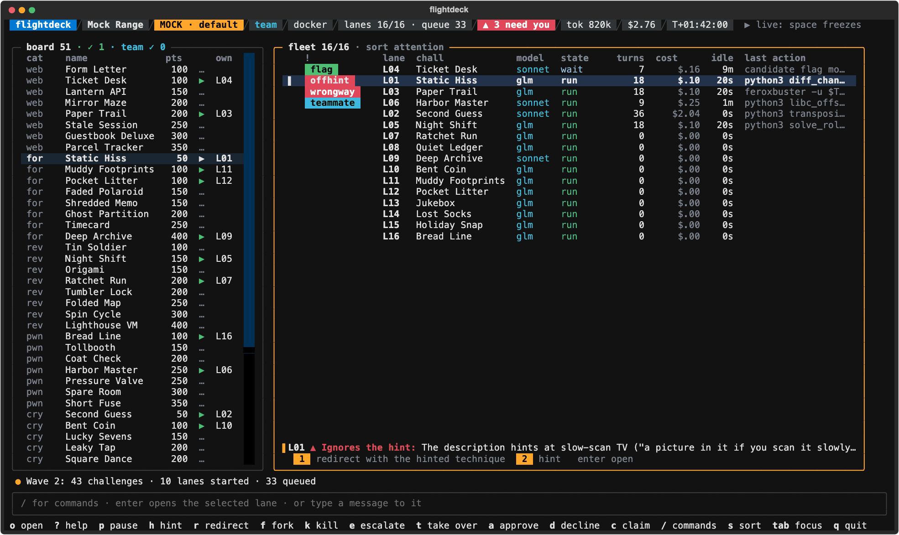
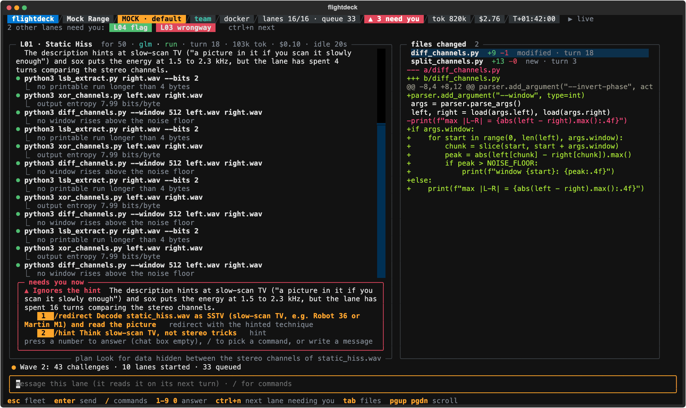

# The player's guide

Everything a player needs after the [README](../README.md)'s quickstart: where lanes run, models
and keys, the console, boards, your own solvers, events and teams, coding-agent lanes, and what a
run leaves behind. Deeper pages: [Model APIs](MODEL-APIS.md), [Models](MODELS.md),
[Boards](BOARDS.md), [Solvers](SOLVERS.md) and the [console spec](CONSOLE-SPEC.md).

## Install and first run

Needs Python 3.12+ on macOS or Linux (Windows through WSL), and Docker for the safest setup.

```sh
pipx install ctf-flightdeck   # or: uv tool install ctf-flightdeck   (from a clone: uv tool install .)
flightdeck init               # a few questions (provider, models, Docker or host); writes your config
# put your key in ~/.config/ctf-flightdeck/keys.env (chmod 600): init names the variable
flightdeck image build        # once, for Docker lanes: pulls Debian and common tools (about 700 MB)
flightdeck doctor             # checks your setup and says how to fix each problem
flightdeck practice           # 14 small practice challenges: spends tokens on your model API
```

`init` shows a numbered list of model APIs: answer with a number or a name. Lanes use one API;
"anthropic, openrouter" together makes OpenRouter the fallback for when Anthropic keeps failing.
A coding-agent CLI (Claude Code, Codex) is not chosen there: `flightdeck play --agent claude`
uses it. For an event, the next command is `flightdeck start` ([Events and teams](#events-and-teams)).

`flightdeck` on its own says what to do next on your machine, and whether your no-model solvers
(L1) are installed. `flightdeck doctor` checks Python,
the config, the key variables, a local model server and its models, the light model, Docker, the
lane image and your terminal's size. Before the console opens, `play` and `practice` ask the model
API whether it takes your key and serves every model in your ladder, and stop with what to fix if
not. `ctfdeck` and `ctf-flightdeck` are other names for the `flightdeck` command.

### Install with Homebrew or apt

Not yet: 0.2.0 is on PyPI only. Both arrive with the first release after 0.2.0, and until then
the commands below find nothing.

```sh
brew install mfisher14/tap/ctf-flightdeck        # macOS or Linux, from flightdeck's own tap

# Debian or Ubuntu: the .deb for your machine (amd64 or arm64) from the release's page,
# https://github.com/MFisher14/ctf-flightdeck/releases
sudo apt install ./ctf-flightdeck_X.Y.Z_amd64.deb
```

The `.deb` brings a Python of its own under `/opt/ctf-flightdeck` (Debian 12 has 3.11, and
flightdeck needs 3.12), so it needs no Python from your system and changes none. There is no apt
repository yet, so `apt upgrade` does not find a new release: install the next `.deb` over the
old one. Neither way installs Docker.

## What a run costs

`practice` and `play` spend money on your model API. Each lane waits for your approval at 400,000
tokens or $2 (`token_cap` and `dollar_cap` under `[lanes]` in your config, with an alert at 80%),
four lanes run at a time by default, and nothing caps a whole run. With
`init --provider anthropic` every lane starts on Claude Haiku 5.5 ($0.10 / $0.50 per million input
/ output tokens). It moves up to Sonnet or Opus 5.5, at 20 to 40 times that, only when you
escalate it. A model on your own machine costs nothing (`init` writes no dollar cap for Ollama or
an MLX server), and `flightdeck mock` spends nothing.

## The mock

```sh
uvx ctf-flightdeck mock              # nothing installed, nothing spent: the console on scripted data
flightdeck mock                      # the default scenario: every alert, then a 43-challenge wave
flightdeck mock --scenario wave      # also: sstv, overthinking, web, team, flag
flightdeck mock --screenshot DIR     # headless: SVGs of the key moments
```

The mock uses no model and no network. Every challenge, teammate and flag in it is invented.
`space` freezes its clock and `.` steps it; the other keys are the real console's
([The console](#the-console)).

## Docker or host

`init` asks where lanes run. A **lane** is one agent working one challenge, with a shell of its
own, and the question is where that shell is.

**Docker** is the default (`runtime = "docker"` under `[lanes]`). Each lane runs in its own
container of the lane image, with only that lane's copy of the challenge in it, and your L1
solvers run in containers too. `flightdeck image build` builds the image once, and
`flightdeck image dockerfile` prints what it builds. A lane of flightdeck's own loop gets no
network unless its challenge has a live instance it may reach: a web origin, or a TCP service like
`nc host port` (`tcp://host:port` in the challenge's `urls`). Under an event whose instance policy
is `confirm`, the lane asks you first.

The network it then gets reaches **that instance and nothing else**: each host and port its
challenge's `urls` name, and for a coding-agent lane (`--agent`) its CLI's API too
(`api.anthropic.com` for claude, `api.openai.com` for codex, port 443). It is never Docker's
bridge network. Per lane, flightdeck makes an internal Docker network, which routes nowhere and
whose name lookups find nothing outside, and for each allowed host a small proxy container, from
the lane image, that carries connections on the listed ports to that host. The proxy answers to
the host's own name on the lane's network, so `nc chal.example.org 1337` or
`curl https://chal.example.org/` works in the lane as the challenge wrote it. Your L1 solvers in
Docker get the same fence. The proxies and the network are removed with the lane, and
`flightdeck doctor` lists any a killed run left (`--clean` removes them).

What that fence does not do:

- **An instance given by IP address, or as `localhost`,** cannot be reached as written from the
  lane's shell: the name `instance-10-0-0-5` stands for `10.0.0.5` and `instance-localhost` for
  `localhost`, on the same ports. The lane's brief tells it so; an L1 solver has to know it. A TLS
  certificate will not match such a name. flightdeck's own http tool takes the URL as written.
- **Only the listed ports, and only TCP.** A port of the instance's host that `urls` does not
  list, UDP and ping go nowhere. So does a redirect or a link to another host: add that host to
  `urls` if it is part of the challenge.
- **`localhost` means this machine.** The proxy reaches it through Docker's host gateway. With
  Docker Desktop that finds a server listening on 127.0.0.1; with Docker Engine on Linux the
  server must listen on an address the bridge network reaches.
- **A proxy looks its host's address up once,** when it starts. An instance that moves to a new
  address needs a new lane.
- **The fence is by host and port.** A host that serves other sites at the same address and port
  serves them to the lane too, and what a coding-agent CLI's API does on its own servers (a
  hosted web search, say) is the API's business.
- **It needs `python3` in the lane image** (the image `flightdeck image build` makes has it) and
  a Docker Engine that can make an internal network without a gateway. Where either is missing,
  or Docker has no room for another network, the lane does not start, or stays without a
  network, and says why. It is never put on the bridge network instead.
- **A coding-agent CLI reaches its API host and no other.** A CLI set up to use another endpoint
  (a gateway, a cloud provider's) does not work in Docker.

**`--host`** (or `runtime = "host"`) runs lane commands as you, on this machine. A lane can read
your files, your keys file and flightdeck's own environment, and send what it reads to its model's
API, which nothing can take back. flightdeck says so before every host run. A lane's commands get
an environment built from an allowlist, with no keys in it. The value of each key flightdeck holds
(every entry of your keys file, the `[api]` and `[fallback]` keys, the CTFd token) is replaced by
its name, like `[OPENROUTER_API_KEY]`, in what a lane's tool calls return, before its model sees
it; so the run log, the console, transcripts, reports and writeup drafts show a key's name but not
its value. That is cleanup, not a fence (a lane that can read a key can also use it, or print it
encoded): use Docker, a disposable VM, or a separate key with a low limit.

A coding-agent CLI holds its own credential, and the commands it runs can read it, in Docker too:
give it a key you can revoke, with a low spending limit. Practise in Docker: on the host, a lane
can read the practice set's reference solutions in a clone of this repository.

## Words used here

- **Board**: a folder of challenge folders, each with a `challenge.json` and its handout files
  ([Boards](BOARDS.md)). With CTFd,
  flightdeck pulls one into a folder.
- **Lane**: one agent working one challenge: a model conversation with its own shell, in a
  container (or on this machine with `--host`). `max_lanes` run at once (4 by default); the rest
  queue.
- **Ladder**: your models, weakest first (`[models] ladder`). Lanes start on the first.
  **Escalate** (`e`) restarts a lane on the next one, with a summary of what it did.
- **Fork** (`f`): a second lane on the same challenge. **Take over** (`t`): the lane's shell is
  yours; exit it to hand the lane back.
- **Caps**: per lane, `token_cap` and `dollar_cap` under `[lanes]`. An alert comes at 80%, and at
  100% the lane waits for you.
- **L1**: your own no-model solvers, which run before a lane's model does anything. They come as a
  **pack** of **engines**, each with a **manifest** saying which challenges it fits
  ([Solvers](SOLVERS.md)).
- **Light model**: an optional small model for small jobs (by default, the hint judge). Off by
  default.
- **Lane image**: the Docker image lanes run in, `ctf-flightdeck-lane:1`.
  `flightdeck image build` builds it once.
- **Event profile** (`event.toml`): what an event's rules allow, and a **policy** for each stage:
  `auto`, `confirm`, `manual` or `off`.
- **Run folder**: where a run's event log, transcripts and reports go
  (`~/.local/share/ctf-flightdeck/runs/`).

## Models and keys

Your config names the environment variable that holds each key, never the key; flightdeck reads
it from your environment, else from the keys file, `~/.config/ctf-flightdeck/keys.env`, which
must be readable by you only:

```sh
mkdir -p ~/.config/ctf-flightdeck && touch ~/.config/ctf-flightdeck/keys.env && chmod 600 ~/.config/ctf-flightdeck/keys.env
# then add one line per key, such as ANTHROPIC_API_KEY=... (and OPENROUTER_API_KEY=... on a line of its own)
```

With an Anthropic key, `flightdeck init --provider anthropic` writes Claude Haiku, Sonnet and
Opus 5.5 with their list prices, so the dollar caps work from the start. If `OPENROUTER_API_KEY`
is set too, it offers OpenRouter as the fallback for a lane whose calls to Anthropic keep
failing. OpenRouter, OpenAI, Ollama, an MLX server or any OpenAI-compatible API work as well.
On the Anthropic API, `[api] effort` sets how hard each ladder model thinks
(`effort = { "claude-opus-5-5" = "high" }`; [Model APIs](MODEL-APIS.md#effort)).
For Ollama or an MLX server, `init` suggests a model, and for any server on your machine it lets
a lane wait up to 10 minutes for a reply of up to 8192 tokens, since a local model can take
minutes to answer. More on [keys](MODEL-APIS.md#keys),
and the fallback, what happens when a model declines, fast mode, time and reply limits, and
prices: [Model APIs](MODEL-APIS.md).

Which models fit your machine? `flightdeck models` looks at it (chip, memory, NVIDIA GPUs, and
the model servers running on it; it contacts nothing but 127.0.0.1) and lists, for lanes and for
the light model, the models that fit and why: open-weight models on your machine first where
they run well, then model APIs. `flightdeck models qwen3.5-9b` prints how to get one and the
config lines that use it. For another machine, describe it: `flightdeck models --memory 16
--apple` (a 16 GB Apple Silicon Mac) or `--memory 32 --gpu-memory 12` (a PC with a 12 GB NVIDIA
GPU). It recommends; it never changes your config. How the models did:
[Models](MODELS.md).

### The light model

A few small jobs can use a small model, set in `[light]`. By default there is none, and
flightdeck's own rules do these jobs. The first job is the hint judge: when a lane seems to ignore
what its description hints at, the alert shows at once, and the light model checks the lane's
steps; if it says the lane is using the technique after all, the alert comes down. `[light] jobs`
can add three more: `route` (a challenge's category where the board names none, and the kind of
specialist it suits), `recon` (a first look at the handout for the lane's opening brief) and
`flagcheck` (a check of a flag before it goes out without you under auto submit; it can only hold
a flag for you, never submit one).

**Recommended: an open-weight model on your own machine**, served by Ollama or an MLX server. No
provider's safety classifier stands between it and security work, and it costs nothing. Measure
one before you switch it on:

```sh
flightdeck eval-local --engine openai --base-url http://127.0.0.1:11434/v1 --model <model>   # scores it beside the rules, job by job
flightdeck init --light ollama --light-model <model>   # a new config; for yours, edit [light] (`flightdeck models ID` prints the lines)
```

`init --light ollama` (or `mlx`) writes `engine = "openai"` with that server's address: both
serve the OpenAI-compatible API. A Claude model or a Strands Decider server can be the light model
too, and one job can have an engine of its own; `flightdeck config --example` shows every setting.
`eval-local` says first how many calls it will make to a paid API.

The light model never holds anything up. When it refuses, fails, times out or answers outside the
options, the rules' answer stands, and the run says so once. A refused request is never sent on to
another model or provider: you see the refusal and decide. Which models to try, and how each did
at each job: [Models](MODELS.md).

## The console

The console raises an alert when a lane spends big on a low-value challenge, ignores what the
description hints at, heads the wrong way on web, loops or stalls. Lanes that need you sort
first, and the line under the list says why and numbers the answers: one key answers.



*An alert with its quick answers, from `flightdeck mock` (invented challenges).*

**Enter** opens a lane full screen: its transcript, the files it changed with diffs, and a chat
box (plain text is a message to the lane; `/redirect`, `/approve`, `/diff` and the rest are
commands; `esc` goes back).



*A lane full screen, from `flightdeck mock` (invented challenges).*

`t` takes over a lane's shell (its container in Docker): exit it to hand the lane back, and the
lane hears what you changed. The shell starts clean: it reads no startup file, and with `--host`
its HOME is a new folder only you can read, outside the workspace, so nothing the lane wrote runs
before you type. `e` escalates a lane to the next model in your ladder with a summary of what it
did, and `f` forks it.

When a model API failure would hit every lane (a refused key, an unknown model, no credits), the
queue is held and the header says why. Once you have fixed it, `/unhold` starts the queued lanes
(a key or model id changed in your config needs a new run).

The queue is held too when the model API keeps failing in a way that may pass (a rate limit, a
5xx, an overload): two lanes in a row end on it within a few minutes, with no reply in between.
The challenges still queued stay queued instead of each being parked in turn. Once the API answers
again, `/unhold` puts the challenges that outage parked back in front of the queue and starts lanes
again. With a `[fallback]` API, a lane moves to it instead of ending.

When several lanes wait with a flag each, `A` (or `/approve all`) answers them together: a prompt
lists each flag by lane and challenge, and `y` approves them, each as `a` would. The flags of one
challenge still go to the platform one at a time, a flag already known wrong is never sent, and
what needs its own answer is left and named: a challenge whose tries the platform counts, a hand
submit, more budget, the live box.

An alert you judge wrong goes away with `x` (or `/dismiss`): the lane is not touched, the alert
stays quiet for the lane's next 3 turns as an answered one does (and comes back after that only
if it still holds), and the run log has it as your action. It works on alerts about a lane's
course; a flag, a budget and a teammate alert have their own answers.

On a phone (flightdeck in tmux, attached over SSH) the console has a compact layout, from 64
columns down: the header keeps what needs you and the run's dollars; each lane's row has its
alert, state and cost; the line under the list wraps the reason and puts one answer on a row, so
`a`, `d` and the number keys work as on a wide terminal. A lane opens with what it needs above its
transcript; the files pane and diffs need 65 columns. `flightdeck doctor` says when your terminal
gets this layout and what it leaves out.

`q` asks first while lanes are open, and a run cannot be resumed.

The fleet's keys act on the selected lane: `p` pause, `h` hint, `r` redirect, `f` fork, `k` kill,
`e` escalate, `t` take over, `a` approve, `d` decline, `x` dismiss, `1`-`9`/`0` quick answers,
`c` claim (team), `/` commands, `s` sort, `?` help (every key and command), `q` quit; `A`
approves every waiting flag; **Enter** opens the lane full screen. The whole design is in the
[console spec](CONSOLE-SPEC.md).

## Play a board

```sh
flightdeck play ~/ctf/some-board --max-lanes 4
```

A board is a folder of challenge folders, each with its handout files and a `challenge.json`
like this one from the practice set:

```json
{"name": "Crab Walk", "category": "crypto", "points": 50, "solves": 312,
 "description": "…", "files": ["postcard.txt"], "id": "crab-walk"}
```

The whole format, with answers files and live instances, is in
[Boards](BOARDS.md).

Lanes start on the lowest-point challenges first (most solves first among equals); the rest
queue. Every lane is a model conversation, capped per lane by `[lanes] token_cap` and
`dollar_cap` (400,000 tokens and $2 by default; an alert at 80%, your approval at 100%).

A challenge is often worked by more than one lane in a run: a fork, a fresh lane after a kill, the
next model up the ladder. A lane that starts on a challenge other lanes worked or still work reads,
after its brief, what each of them tried: its plan, the programs it ran, its last steps, what
became of its flags, the alerts on it and how it ended. flightdeck writes that record itself from
what the lanes did (no model is asked to), it is handed over as data like the challenge's own
text, and it is kept short (3,000 characters). The same record is in the run folder as
`shared.json` when the run ends.

Challenges whose names share a start are a series ("Harbor Lab: Read the Certificate", "Harbor
Lab: Fingerprint the Certificate"; [Boards](BOARDS.md#a-series-of-challenges) has the rule). A lane
on one of them is told of its siblings: which are solved, what the lane that worked a sibling
found, and where that lane's files are, to read and not to change: the folder itself on the host
runtime, `/series/<challenge id>` in Docker (mounted read-only). A lane that still runs shares no
files. A sibling's flag is never in the brief. A lane's log says what its brief was given.

A flag a lane finds waits for you: `a` or `1` submits it, `d` or `0` declines. On a folder board
flightdeck checks a flag against the board's `answers.sha256.json` when it has one. Without one
it cannot check: submit the flag on the platform yourself, then press `a` if it was accepted or
`d` if not. With `--event`, `a` sends it to CTFd (when the event's submit stage is `manual` or
`off`, you submit it and answer `a` or `d`).

To turn auto approve on while a run is going, type `/config submit auto` in the console
(`/config submit confirm` turns it off, and `/config` alone shows the run's settings). To start
with it on, pass `--submit auto` or set `submit = "auto"` under `[lanes]` in your config.
`/config lanes 8` changes how many lanes run at once, and `/config lanes unlimited` lifts the
limit (`max_lanes = "unlimited"` in the config does the same from the start).

Under auto submit (`submit = "auto"`, or `play --submit auto`) a flag the model submits goes at
once, unless it is written in the challenge's own description or handout files (often a decoy):
that one still waits for you. A flag found wrong is never asked about again.
Once the platform has called three flags wrong at one challenge, that challenge's next flags wait
for you as well (`wrong_stop = 3` under `[lanes]`; 0 turns it off): a lane that is guessing does
not get to spray the platform. A flag CTFd rate-limited without checking it is sent again by
flightdeck after the wait CTFd asks for, up to three more times, before it comes back to you.

A right solve can lose its spelling on the way: a cipher with one letter case gives the flag in
capitals, a decoder wraps a wrapped flag twice. With `variant_tries = 2` under `[lanes]` (0, the
default, turns it off; 12 is the most), when the platform calls a flag wrong flightdeck proposes
its other spellings on the same lane, best first: the lost case, the doubled wrapper, leet and
letters, accents, spaces and underscores, the prefix as the event's flag format spells it. One
at a time, the next only after the platform called the one before wrong, and at most that many
per challenge in a run. A variant is a flag like any other: under `submit = "confirm"` it waits
for you, and under auto submit it goes out only where a flag the lane claims would (never past
`wrong_stop`, never on a challenge whose tries are counted, never when its first spelling went
out on your yes), so a wrong one is a wrong try at the platform. The approval and the lane's
transcript say which flag it is a variant of and what changed.

Some platforms limit the tries at a challenge's flag (CTFd's "max attempts"). Every flag for such
a challenge waits for your approval, under auto submit too, and the approval says how many tries
are left. To let auto submit spend those tries without you, the last one included, set
`submit_limited = "auto"` under `[lanes]`; a wrong flag can then use up the tries for your whole
team. flightdeck says so when a run starts.

Some challenges hand out a flag that rotates every few minutes. Say so in the challenge's
`challenge.json` (`"rotates": 300`) and flightdeck sends such a flag only in the window it was
found in, telling the lane to fetch a fresh one otherwise: [Rotating flags](BOARDS.md#rotating-flags).

Every run writes a run folder with an append-only `events.jsonl`, each lane's transcript and a
`status.json` that says how the run stands ([the status file](#the-status-file)); a
board with answers (like the practice set) ends with a scorecard, and any other run with one line
that says what it spent: its tokens and dollars ("at least" when some spend had no price). If
flightdeck itself is killed
(kill -9, a power loss), what its lanes started can keep running: the next `play` or `practice`
removes it and says what it removed, `flightdeck doctor` lists it and `flightdeck doctor --clean`
removes it.

## Headless runs and notifications

```sh
flightdeck play ~/ctf/some-board --headless                       # no console
tmux new -d -s deck 'flightdeck play ~/ctf/some-board --headless'  # in tmux, detached
nohup flightdeck play ~/ctf/some-board --headless > run.out 2>&1 &   # or under nohup
```

`play --headless` (and `practice --headless`) plays the board with no console. The rules are the
same as at the console, and nobody is watching, so **nothing is approved or declined**: a flag
under `submit = "confirm"`, a budget or a live box waits, exactly as it would on your screen. Under
`--submit auto` the flags auto submit would send go out as usual and the rest wait. When the run
ends, its exit lines name every flag that was left waiting.

A headless run prints where its status file is, then flies until:

- you stop it: `kill PID` (SIGTERM), Ctrl-C, or closing its terminal (SIGHUP; under `nohup` a
  hang-up is ignored, as nohup means it to be). Every lane stops and every workspace closes, as
  when you quit the console, and the exit status is 128 plus the signal's number (143 for
  SIGTERM);
- or nothing is left to do: no lane is open, nothing is queued, the queue is not held and no flag
  is on its way to the platform. It then exits with status 0. A lane that waits for your approval
  is open, so a waiting flag keeps the run up until you stop it. A run that can still get work (an
  event whose board is pulled again for new challenges, a team folder) never ends on its own.

An event whose pull policy is `confirm` cannot be played headless: there is nobody to ask before
the pull. Set `pull = "auto"` in the profile.

### The status file

Every run, with the console or headless, keeps `RUN_DIR/status.json` up to date: after the run's
events (within half a second), every two seconds besides, and a last time when the run has shut
down. Each write replaces the whole file at once, so a reader never sees half of one. It is how a
script, a tmux pane or a phone over SSH sees the run:

```sh
cd ~/.local/share/ctf-flightdeck/runs/20261112-101500     # the run folder play printed
jq '.needs_you' status.json                                # who waits for you, most urgent first
jq -r '.lanes[] | "\(.id) \(.state) \(.challenge.name) $\(.dollars)"' status.json
jq '.queue, .totals' status.json
watch -n 2 "jq -c '{needs: [.needs_you[].lane], solved: .challenges.solved, spent: .totals.dollars}' status.json"
until jq -e '.closed' status.json > /dev/null; do sleep 5; done   # wait for the run to end
```

| Field | What it holds |
|---|---|
| `format` | 1. A change that breaks a reader raises it. |
| `flightdeck` | The version that wrote the file. |
| `written` | When this write was made (UTC, ISO 8601). |
| `run` | The run folder's name. |
| `event` | The event's name. |
| `runtime_seconds` | Seconds since the run started. |
| `closed` | `true` in the last write, once the run has shut down. |
| `lanes` | Each lane, by number: `id`, `challenge` (`id`, `name`), `state` (`run`, `wait`, `paused`, `takeover`, `solved`, `killed`, `stopped`, `gave up`), `model`, `turns`, `tokens`, `dollars` (what is known), `unpriced` (some of its spend had no price), `needs_you`, `pending` (null, or the approval it waits for: `kind`, `detail`, `flag`), `waiting` (further approvals behind that one), `alerts` (each `kind` and `reason`), `result` (one line, once it ended). |
| `needs_you` | The lanes that need you, most urgent first, in the console's attention order: `lane`, `challenge` (its name), `pending` (the approval's kind, or null), `alerts` (the kinds that want an answer). |
| `queue` | `length`, `held`, and `held_reason` (null unless held). |
| `totals` | `tokens`, `dollars` and `unpriced` over all lanes: the console's header. |
| `challenges` | `total` and `solved`. |
| `solves` | Each solved challenge: `id`, `name`, `points`, `by` (a lane, `me` or a teammate) and `teammate`. |

Like the run log, the file names the flags lanes found, so it is readable by you alone (mode 600).
It holds no key or token: each one flightdeck holds shows as its name in brackets, and anything
shaped like a credential as `[redacted]`. Its text comes from challenges and lanes: long fields
are cut, and a script should treat every string in it as data.

Approving or declining from the status file, or from a phone, is not built: answer at the console
(stop the headless run and play the board again, or play with the console in tmux from the start).

### Notifications

flightdeck can tell a webhook when a run has news. It is off unless you turn it on:

```toml
[notify]
webhook_env = "FLIGHTDECK_WEBHOOK"            # the variable that holds the URL, never the URL itself
on = ["flag", "needs-you", "disengaged"]     # the default: all three
```

```sh
echo 'FLIGHTDECK_WEBHOOK=https://example.com/hooks/your-token' >> ~/.config/ctf-flightdeck/keys.env
```

A webhook's URL usually holds a token, so flightdeck treats it as a key: it comes from your
environment or `keys.env`, the config only names its variable, and it is never logged, shown in
an error or written to the run folder. A variable that is named and not set stops the run before
it starts, and so does one that holds anything but an `http://` or `https://` URL.

Each message is one HTTP `POST` with `Content-Type: application/json` and exactly this body:

```json
{
  "flightdeck": "0.2.0",
  "format": 1,
  "run": "20261112-101500",
  "event": "Some CTF",
  "kind": "needs-you",
  "lane": "L03",
  "challenge": {"id": "crab-walk", "name": "Crab Walk"},
  "need": "submit",
  "text": "L03 has a flag for Crab Walk: it waits for your approval"
}
```

| Field | What it holds |
|---|---|
| `flightdeck` | The version that sent it. |
| `format` | 1. |
| `run` | The run folder's name. |
| `event` | The event's name, at most 80 characters. |
| `kind` | `flag`, `needs-you` or `disengaged`. |
| `lane` | The lane's id; null for `disengaged`. |
| `challenge` | Its `id` and `name` (each at most 80 characters); null for `disengaged`. |
| `need` | For `needs-you`: the approval's kind (`submit`, `confirm`, `budget`, `live box`) or the alert's (`budget`, `loop`, `stall`, `effort`, `hint`, `direction`). Null otherwise. |
| `text` | One line for a person to read, at most 200 characters. |

Nothing else is sent: no header beyond `User-Agent: ctf-flightdeck/VERSION`, no key, no path, no
file, no description, no transcript.

| `kind` | Sent when |
|---|---|
| `flag` | A flag was accepted, by the platform or by the board's answers file. Not when you confirm a hand submit yourself. |
| `needs-you` | A lane waits for a new approval, or raised a new alert that wants an answer. At most one a minute for each lane and need, so a noisy lane cannot flood you. |
| `disengaged` | No more lanes start: the queue is held (the model API refuses the key, or keeps failing), or autopilot disengaged. `text` says why. |

**A flag's value is never sent.** A webhook is someone else's server, often a channel other people
read, and a flag there before it is submitted is a flag given away. The message says that a flag
waits or was accepted, and for which challenge; the flag itself is on your machine, in the console
and in `status.json`. `text` is cleaned before it leaves: keys flightdeck holds show as their
names, anything shaped like a credential as `[redacted]`, anything that matches the event's flag
format as `[flag]`, and control characters are made visible. The challenge's name and the event's
name come from the board, cut to length, with control characters made visible too.

Sending never slows a run down. Messages go out one at a time from a background task, each with
five seconds to be answered; at most 32 wait, and one more is dropped (said once). A message that
fails is not sent again, a redirect is not followed, your proxy settings are not used, and a
failure shows as one warning in the console and the run log while the same failure lasts, without
the URL. The receiver is yours to choose: any service that takes a JSON `POST`, or a few lines of
your own that pass `text` on to your phone.

## Your solvers first (L1)

Point flightdeck at a folder of your no-model solvers and each lane runs the ones that fit its
challenge before its model does anything: before the first model call of flightdeck's own lanes,
and before a coding-agent lane's CLI is started. So a solve can cost no tokens at all.

```sh
flightdeck l1 import ~/ctf/solvers        # manifests for a folder of plain scripts (the scripts are never changed)
flightdeck l1 list ~/ctf/solvers          # every engine in the pack, with its routes
flightdeck l1 route ~/ctf/solvers ~/ctf/some-board/crab-walk   # which engines a challenge reaches, and why (or why not)
flightdeck l1 run ~/ctf/solvers ~/ctf/some-board/crab-walk     # run them now: on this machine, as you, with no container
flightdeck play ~/ctf/some-board --pack ~/ctf/solvers          # or set [l1] pack in your config
```

`l1 import` takes a `.py` file with an `if __name__ == "__main__":` block, or any executable
script with a `#!` line, and routes it by its folder's name (`crypto/`, `forensics/`) and the
words of its file name. To write a manifest yourself, or an engine that reports its evidence:
[Solvers](SOLVERS.md).

A flag an engine returns as its result waits for your approval, or under auto submit goes to the
platform at once; a flag that is only a match in what an engine printed (a plain script that
`l1 import` took in, say) always waits for you. When lanes run in Docker, so do your solvers: each
in a container of the lane image, your pack mounted read-only, with no network unless the
live-instance policy is `auto` and the challenge has an instance. With `--host` they run on this
machine, as you.

## Events and teams

One command sets an event up and plays it:

```sh
flightdeck start
```

It asks, in order: the event's name; a folder for it (`~/ctf/<name>` unless you say otherwise,
made for you); whether the rules allow AI tools (flightdeck does not play an event that forbids
them); how the challenges arrive (**ctfd**: the site runs CTFd, and flightdeck pulls the board
and submits flags; **by hand**: any other site); the site's address; what a flag looks like
(`PP` for `PP{...}`); whether a flag waits for you or goes at once; and your CTFd access token
(on the site: Settings, Access Tokens, Generate). The token goes into your keys file under a
variable of this event's own, never into the event's folder, and is never shown. Then it says
whether the solver pack is installed (and offers to install it), and launches.

What it leaves:

```
~/ctf/example-ctf/
  event.toml   the event's rules, from your answers: edit it any time
  board/       the challenges: pulled from CTFd as you play, or put there by you
```

`flightdeck play ~/ctf/example-ctf` plays that event again, with no option to remember: a folder
with an `event.toml` in it is played by that file. `flightdeck start ~/ctf/example-ctf` does the
same for a folder already set up. Every question has an option (`flightdeck start --help`), for
a script.

By hand: for each challenge make a folder under `board/`, put its files there and a
`challenge.json` beside them ([Play a board](#play-a-board) shows one), then `flightdeck play`
the event's folder. flightdeck shows each flag; you submit it on the site and press `a` if it
was accepted or `d` if not.

To write the event file yourself instead, from the event's rules:

```sh
flightdeck preflight --example > event.toml      # then edit it from the event's rules
flightdeck preflight event.toml                   # what flightdeck will do at each stage, and any problem
export CTFD_TOKEN=...                             # the variable event.toml names (never the token itself)
flightdeck play ~/ctf/event-board --event event.toml
```

flightdeck talks to CTFd and to a Game Master. For any other platform, make a folder board (`platform = "manual"` in
`event.toml`) and submit flags by hand.

With a CTFd event, flightdeck pulls the board into that folder (and, with `pull = "auto"`, adds
new waves as they appear), submits the flags you approve through CTFd and follows your team's
solves. A slow CTFd never holds up the console: lanes carry on while their flags are on their way
(the fleet shows `sending`). A challenge whose tries CTFd counts always waits for you, under
`auto` too, and each approval says how many tries are left. `flightdeck ctfd pull URL FOLDER`
pulls a CTFd board without playing it; it exits with status 1 when some challenges could not be
pulled.

A Game Master event (`platform = "gamemaster"`) is played from a board you pull first:
`flightdeck gm pull URL FOLDER` writes the attempts that are started, one challenge per answer,
and names what it left unstarted; `--start` starts the ones that run no clock, and flightdeck
never starts a clocked one. A lane submits an answer as `answer{...}`, and what is inside goes to
the Game Master. Its replies: `CORRECT` and `accepted` (that answer is banked, others of the
attempt remain) solve the challenge, `incorrect` is a wrong answer, and anything else (the
attempt not started or expired, a refused request, a rate limit that outlasts three more sends,
a word flightdeck does not know) is no verdict: the answer comes back to you to submit by hand,
never recorded as wrong. A challenge the Game Master lists as solved is closed. The run starts
no attempt and pulls nothing. More in [BOARDS.md](BOARDS.md#a-board-from-a-game-master).

Each stage (pull, L1, agents, submit, live instance) has a policy in the event profile: `auto`,
`confirm` (you say yes first; for agents and L1, starting play is that yes), `manual` or `off`,
never looser than the rules. With agents `manual` or `off`, `play` does not start. Under `confirm`
for live instances, a lane asks before it may reach its challenge's instance and has no network
until you allow it; then, and under `auto` from its start, a Docker lane's network reaches that
instance and nothing else ([Docker or host](#docker-or-host)). The profile, key by key:
[Boards](BOARDS.md#the-event-profile-eventtoml).

Team mode shares claims, live-box holds and solves through a folder your teammates sync (a network
drive, Syncthing): `flightdeck team init DIR` once, then `play --team-dir DIR`. Your lanes never
work a challenge a teammate solved. `--handle NAME` sets your name in the team folder (by default,
your login name), and `flightdeck team status DIR` shows what the folder holds and which files
flightdeck ignores there.

## Autopilot

Autopilot runs an event end to end while you are away. It is rules in code, not a model, and it is
never looser than the event's rules: it changes no policy, so each stage goes as far on its own as
your event profile and config already allow.

```
flightdeck play BOARD --event event.toml --autopilot --budget-dollars 20
```

**To engage it** give `--autopilot` (on `play` or `practice`), or set `engage = true` under
`[autopilot]` in your config. It needs two things, and `play` does not start without them, saying
which is missing:

- **A run budget**, for the whole run: `--budget-dollars`, `--budget-tokens`, or `budget_dollars`
  and `budget_tokens` under `[autopilot]`. Give one or both. With dollars alone, a model with no
  price stops autopilot at its first turn, so give tokens too if your ladder has one.
- **The Docker runtime.** There a lane reaches its challenge's own instance and nothing else; on
  the host runtime flightdeck cannot hold a lane to that.

Before lanes start, `play` prints what autopilot will and will not do in this run, for example
"submit is confirm under this event's rules, so every flag waits for you".

**The schedule.** If the event profile says `start` and `end` ([BOARDS.md](BOARDS.md)), autopilot
waits for the start before it pulls anything (Ctrl-C stops the wait) and stops the run at the end,
as quitting does. Under the pull policy `auto`, new waves are pulled on the usual timer.

**What it does by rule:**

| When | Autopilot |
|---|---|
| A lane stalls | escalates it one rung; at the top rung, kills it and parks the challenge |
| A lane loops | kills it and parks the challenge for the next round |
| A lane ignores the hint, or goes the wrong way on a web challenge | redirects it to the alert's suggestion, once per lane |
| A lane's effort is out of proportion to the challenge | kills it and parks the challenge for the next round |
| A lane asks for more budget (its own cap) | approves it while the run budget has room: the lane's caps go up a step and it carries on (a lane whose spend has no price waits for you) |
| The queue is dry and no lane runs | queues each unsolved challenge a lane gave up on, on the next model up, lowest points first, once per rung |
| A challenge's only lane has run `second_after` seconds unsolved, or the platform called a flag of it wrong (only when you set `second_after`) | forks a second lane on another model of your ladder, once per challenge |
| The first of a challenge's two lanes has run `third_after` seconds (only when you set `third_after`) | forks a third lane on a model neither runs, once per challenge |

The last two are off until you set them, in seconds, under `[autopilot]`: `second_after = 180` and
`third_after = 480` are a second opinion after three minutes and a third after eight. They need a
ladder with two and three models, and each fork spends from the run budget like any lane.

Under `submit = "auto"` a flag a lane claims is submitted, as without autopilot. A lane that is
paused or taken over, or that waits for your answer, is left alone.

**What it never does:**

- answer a flag or a live-box request for you: a flag that waits (every flag under `confirm`, a
  scraped one, one the flag check holds) waits for you;
- guess a flag, or submit anything itself;
- spend a challenge's last counted try, `submit_limited = "auto"` or not: that flag waits for you,
  and the run goes on. A challenge whose count the platform has not given is not held back;
- send a request a model declined on to another model or provider: Anthropic's server-side refusal
  fallback is off while autopilot has the run, and a challenge a model declined stays parked;
- start a lane, or go on spending, past the run budget.

**When it disengages** it holds the queue, stops its rules and says why, in the console and in the
run log: the run budget reached (the lanes are paused too), spend with no price under a budget in
dollars alone, the model API failing for every lane, the platform failing or not judging a flag,
a web page where CTFd's API should answer (a login page, a CAPTCHA: flightdeck never tries to pass
one), or the event's end. Its guardrails stay until you are back.

**To take over,** do anything: after a disengage your first key or command turns autopilot off,
and `/unhold` lifts the hold on the queue. While it is engaged you can step in at any time without
switching it off, and `/autopilot off` hands you the controls. `/autopilot on` engages it again
(refused, with the reason, without a budget, off Docker, while the queue is held, or once the
budget is spent). The header says `AUTOPILOT` while it is engaged.

After the run, the post-flight report has an Autopilot section (what it did by rule, each
disengage and why), and neither it nor the flight card counts autopilot's interventions as yours.
`flightdeck mock --scenario autopilot` shows it on fake data.

## Coding-agent lanes

`--agent claude` (or `codex`) runs lanes as that coding-agent CLI, on any board or event, behind
the same controls. Each uses its own models (`[agents]` in your config: claude defaults to
`sonnet`, then `opus`; codex needs a ladder) and its own credential, never your `[api]` key.

- **claude** takes `ANTHROPIC_API_KEY` (the Anthropic API, billed per token) or
  `CLAUDE_CODE_OAUTH_TOKEN` (your Claude subscription; `claude setup-token` makes one).
- **codex** takes `CODEX_API_KEY` or, on the host only, a saved `codex login`.

Put the credential in your keys file or your environment; `--agent-auth` picks one when both are
set. In Docker the lane image needs the CLI, and the image `flightdeck image build` makes has
neither: build an image `FROM ctf-flightdeck-lane:1` that installs it and set `[lanes] image` to
it, or play with `--host`. `flightdeck doctor --agent claude` checks the CLI, its credential and
the lane image.

In Docker a coding-agent lane's network reaches its CLI's API (`api.anthropic.com` or
`api.openai.com`, port 443) and its challenge's instance, and nothing else
([Docker or host](#docker-or-host) says how, and what does not work). That has been tested with
a stand-in CLI, not yet with the real ones: if your CLI needs another host to start, its lanes
fail at their first turn, and `--host` is the way round until it is added. A coding-agent lane
does not ask before it reaches its instance, so an event whose instance policy is not `auto`
refuses agent lanes. A CLI says what a
turn cost only when the turn ends, so its lane's cost ends in `…` until then; codex reports no
cost at all, so give its models a `[prices."<model>"]` table for their lanes to show dollars.

With a pack ([Your solvers first](#your-solvers-first-l1)), a coding-agent lane runs your L1
engines before its CLI is started, by the same rules as flightdeck's own lanes. While a flag an
engine found waits for you, no CLI runs, and if that flag solves the challenge none is ever
started. Otherwise the CLI's opening brief says what the engines found, as data.

## After a run

```sh
flightdeck report RUN_DIR      # where lanes stalled, which interventions helped, cost per solve
flightdeck writeups RUN_DIR    # a writeup draft per solved challenge (--redact hides the flags)
flightdeck score RUN_DIR       # the run scored against the board's answers
flightdeck gaps RUN_DIR        # the challenges your L1 solvers did not solve, and why
flightdeck build gap CHALLENGE_DIR --pack ~/ctf/solvers   # a new engine stub with a test that must pass
flightdeck build check ~/ctf/solvers                       # run the pack's tests: which engines pass
flightdeck share RUN_DIR       # the run's flight card, to post: no flags, no challenge names
```

In place of RUN_DIR, the word `latest` means your newest run (the newest by start time under
`[run] dir` in your config), and the command names the folder it took. With `--pack`, each gap
`flightdeck gaps` lists ends with the `flightdeck build gap` command for it, ready to paste.

When a run ends, `play` prints its run folder with the report, writeups and gaps commands for it
(and score, when the board has answers), ready to paste. A lane's transcript
(`RUN_DIR/lanes/L01.jsonl`) keeps more than the console showed: every tool call of each turn, with
up to 40 lines of its output, where the console's step is the turn's first call and 3 lines. A
writeup draft shows each step that mattered with all of its turn's tool calls, 20 lines of output
each. `writeups --polish MODEL` has MODEL tidy
the prose through the API in your config: it spends tokens, and never sees the run's flags,
commands or outputs.

A key flightdeck holds shows as its name in brackets wherever a lane met its value. Beyond those,
transcripts, the run log, reports and writeup drafts replace the value of anything shaped like a
credential with `[redacted]`, with or without `--redact`: an upper-case `NAME=value` naming a
key, token, secret, password, cookie or auth; Authorization, Proxy-Authorization and Cookie
headers; well-known key prefixes (the full rule is in the
[architecture](ARCHITECTURE.md#credentials)).
Anything else stays, lower-case names included (a `password` is everyday CTF content), so read a
draft before you share it.

### Share a flight card

`flightdeck share RUN_DIR` prints the run's **flight card**: flightdeck's version, where lanes
ran, the models, solves by category, time, tokens and dollars by model, how often you approved
and how often you steered, and the run's mode (hands-on, approve-only or hands-off:
[the leaderboard](LEADERBOARD.md#mode-how-hands-on-the-players-were) defines them). It is made
to be posted, so it holds no flag, no challenge name or text, no event name, no path and no
address; a category the board named in its own words shows as `other`. `--name TEXT` adds your
own label.

Nothing is sent anywhere. The card goes to your terminal (`flightdeck share RUN_DIR > card.txt`
keeps it), and you post it if you want to:
[a flight card issue](https://github.com/MFisher14/ctf-flightdeck/issues/new?template=flight-card.yml).
The setup lines come from `setup.json`, which a run writes in its folder when it starts; a run
from before 0.3.0 has none, and its card says so.

## Configuration and files

`flightdeck init` writes `~/.config/ctf-flightdeck/config.toml` (or the file `$FLIGHTDECK_CONFIG`
names). `flightdeck config` checks it, and `flightdeck config --example` prints every key with
its default. Keys come from your environment, else from `~/.config/ctf-flightdeck/keys.env` (or
the file `$FLIGHTDECK_KEYS` names). Each run writes a folder under
`~/.local/share/ctf-flightdeck/runs/` (`[run] dir`, or `--run-dir`). flightdeck keeps notes of its
own in `~/.local/state/ctf-flightdeck/` (or under `$XDG_STATE_HOME`). `l1 import` writes manifests
into `FOLDER/.flightdeck/generated/`.

To remove flightdeck: `pipx uninstall ctf-flightdeck` (or `uv tool uninstall ctf-flightdeck`),
`docker image rm ctf-flightdeck-lane:1`, and delete those folders.

### The host governor

A run that starts lanes faster than your machine can carry them loses all of them. So before a
queued lane starts, flightdeck looks at three readings, and while one is past its limit no new
lane starts:

| Reading | Limit in `[governor]` | Default |
| --- | --- | --- |
| The 1-minute load average divided by the CPUs | `max_load_per_cpu` | 3.0 |
| The RAM available without swapping, in MiB | `min_free_ram_mb` | 2048 |
| The free disk where the run folder is, in MiB | `min_free_disk_mb` | 10240 |

The lanes at work carry on: the governor never stops or pauses one, and the queue keeps its
order. One warning says when starts begin to be held and which limit it is, with the reading,
and one says when they start again; that happens by itself (the machine is read every 15
seconds), with nothing for you to lift, and autopilot stays engaged. With no lane at work, one
lane always starts. A limit of 0 is off, and `enabled = false` turns the governor off. A reading
flightdeck cannot take (it reads macOS and Linux) holds nothing back, and the run says so before
it starts. `flightdeck doctor` shows the readings in its `host` line.

## Optional extras

- `ctf-flightdeck[build]`: pytest, for `flightdeck build check`.
- `ctf-flightdeck[cactus]`: Cactus Needle, a small on-device model that can be the light model
  (`engine = "cactus"`). flightdeck's own measurement found it unfit for the light jobs
  ([Models](MODELS.md)), so measure it
  with `flightdeck eval-local --engine cactus` before you use it. Its telemetry is turned off, and
  nothing uses it unless you ask.
